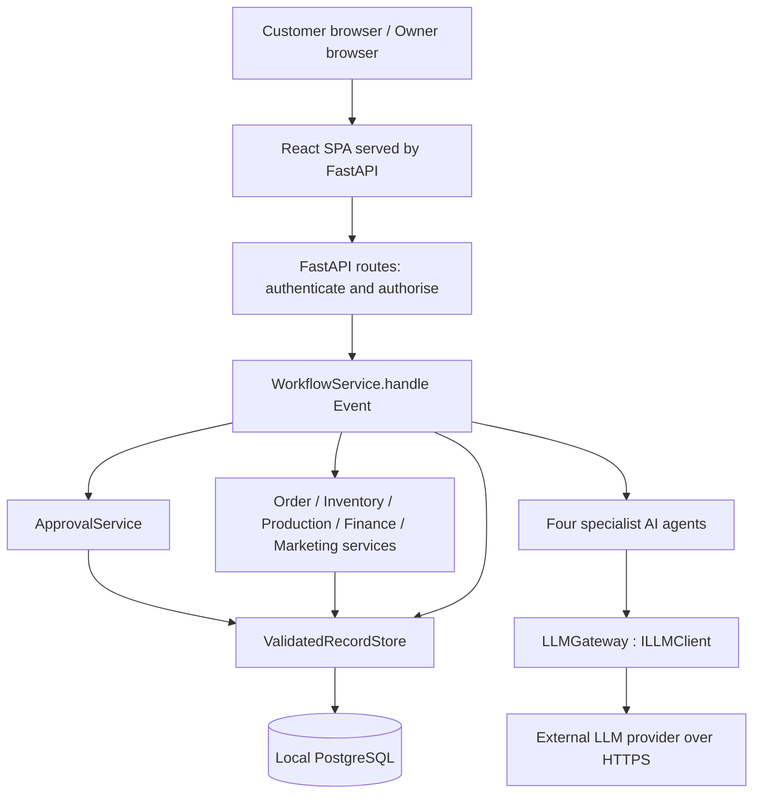

# BakeFlow AI — Stage 2 Implementation Architecture

Draft for team review. Nothing is implemented yet.

Drafted with AI assistance (ChatGPT and Claude) from the Stage 1 report. Not yet reviewed by the team; open decisions are listed in section 3.

**Status:** Proposed architecture, 18 October 2026; decision meeting: Monday 19 October. **Repository destination:** `docs/architecture.md`. **Design authority:** submitted Stage 1 report, especially §1–§15 and Fig. 1–26. **Delivery deadline:** Sunday 1 November 2026, 23:59 Sydney time; deployment from the downloaded Canvas submission during the Week 13 demonstration (Stage 2 instructions).

## 1. Purpose, scope, and document status

BakeFlow AI is a browser-based, AI-assisted back office for one home-based bakery. Customers submit custom cake and cupcake requests, confirm their requirements, inspect orders and accept approved quotations. The owner resolves recipe/allergen exceptions, approves quotations and production schedules, records transactions, reviews profitability, and approves campaigns and promotional content. Four specialist agents **interpret, explain, plan and propose**. Deterministic services **calculate, validate and persist**. The owner authorises consequential actions. This separation follows §1.1–1.3, AR-01–AR-04 and §7.1–7.3.

This is an **implementation proposal, not an as-built account**. No application code has been implemented at the time of drafting. Open decisions, story owners, schedules and estimates are proposals until the team confirms them and updates Jira. A Stage 2 extension is not silently presented as Stage 1 functionality.

| In scope for the prototype | Excluded or bounded |
|---|---|
| UC-01–UC-08; IP-01–IP-05; current-version approvals; record and transition audit; one shared database | Physical baking, actual ingredient purchasing, delivery optimisation, tax/legal/medical/food-safety advice (§15) |
| Four specialist AI agents, real-provider demo path, explicitly labelled Mock mode, fixed-input evaluation | AI coordinator, autonomous business approvals, LLM-generated financial/stock truth, direct LLM database access |
| Optional BAKE-37–40 as tightly limited Stage 2 extensions [O1]–[O4] | Real payments or banks; publication to real social platforms; general event bus, pub/sub, message broker, or autonomous event subscribers |
| Local one-host demonstration and replayable seed data | Multi-tenant scale, multi-owner simultaneous editing design, public production hosting |

**Rubric alignment:** Rubric-1 (7 marks) drives complete UC/IP coverage; Rubric-2 (4) drives agent evidence; Rubric-3 (4) drives Jira and review evidence; Rubric-4 (5) drives justified framework, deployment and CI choices. The rubric provides examples of advanced technology; it does **not** require LangGraph, RAG, cloud hosting or Kubernetes.

## 2. Drivers, principles, and decisions preserved from Stage 1

| Driver | Architectural rule | Stage 1 trace |
|---|---|---|
| Discrete stateful bakery workflows | `WorkflowService.handle(event: Event)` selects exactly one matching transition, directly invokes named services and records decisions. Agents never select system-wide routes. | §3; §7.1–7.3; Fig. 17, 21–24 |
| Exact and auditable decisions | `OrderService`, `InventoryService`, `ProductionService`, `FinanceService` and `MarketingService` own calculations and business validation. `ValidatedRecordStore` commits authorised changes with `AuditEntry`. | §1.3; §8; AR-02–AR-04 |
| Human authority | `ApprovalService.request`, `decide`, and `is_approved` bind decisions to `RecordRef(type, id, version)`; draft persistence is not action authorisation. | §3; §8; UC-04, UC-05, UC-07, UC-08 |
| Bounded, non-deterministic AI | All agents implement `AIAgent.execute(TaskRequest) -> TaskResult`; only `LLMGateway` implements `ILLMClient` and calls the external provider; invalid/failed operations receive at most two retries. | §1.3; §8; Fig. 5, 9, 16 |
| One bakery, shared constraints | IP-02 availability counts other active approved but not-yet-deducted orders once; IP-05 enforces one team, non-overlapping work, daily work-minute budget and deadlines. | IP-02, IP-05; UC-04 2, 5, 8 |
| Stable completed work | Ingredient deduction is once per order, after all its production tasks complete, and is atomic with a durable deduction record. Task progress never increments `ProductionSchedule.version`. | IP-01, IP-04; Fig. 10, 22 |
| Incremental prototype | Four business modules share coordination, AI support and validated persistence, and deploy as one backend application with a local SQL database. | §7.2–7.4; §13–14; Fig. 25–26 |

**Four preserved patterns:** layered (interface/control/logic/data), workflow-controlled, shared-data and **event-triggered progression through direct in-process calls** (§7.2). “Event” is a typed command input to `handle`; it is **not** a queued message, event-sourcing infrastructure, a publisher, or a subscription mechanism. No generic handler registry is introduced. The original decision to remove the Coordinator Agent is retained (§16).

### 2.1 Proposed runtime boundary



The diagram shows responsibilities, not additional independently deployed services. AI computation occurs outside database transactions. All persistent business writes are validated and authorised in-process (Fig. 1; §7.2; Fig. 26).

## 3. Assumptions and open decision log

| Assumption | Proposed working rule / risk |
|---|---|
| Delivery capacity | Four contributors have approximately 25–30 focused hours each per week (200–240 team-hours over two weeks). **This is an unverified planning assumption**; Jira points are not hours. Zero measured Sprint 1 velocity makes the 135-point backlog high risk. |
| Local execution | Docker Compose works on every developer machine and on the demonstration laptop; use one database engine in development, CI and demonstration. |
| Prototype identity | One owner account, customer-specific access, simulated bakery data, products with one recipe each (§15); a demo-only local session is not a production identity service. |
| Scheduling | One production team; work intervals are half-open `[start, end)` in the bakery time zone; all persisted timestamps are UTC, rendered in `Australia/Sydney` [R10]. |
| Security and provider | Real LLM traffic uses HTTPS, keys remain server-side. Network availability and campus proxy access are not guaranteed on demo day. |
| Change approval | The Stage 1 report is normative; proposed extensions are separately identified in §10, and no extension silently overrides an existing rule. |

**Every entry below is pending team, 19 Oct.** A primary choice is specified so development has one coherent target; alternatives are short deltas, not parallel architectures.

| ID | Decision — status | Primary working decision | If the team chooses differently |
|---|---|---|---|
| **OD-1** | Backend language — **pending team, 19 Oct** | Python, FastAPI, Pydantic, SQLAlchemy and Alembic | Use Node/TypeScript, NestJS or an equivalent structured HTTP framework, an ORM with migrations, schema validation and decimal arithmetic; keep contracts, transactions and view boundaries unchanged (§9). |
| **OD-2** | Database — **pending team, 19 Oct** | PostgreSQL via Docker Compose on all machines | If any team/demo laptop cannot run Docker reliably, choose SQLite **for all** development, tests and demo; replace `SELECT FOR UPDATE` on the shared guard with `BEGIN IMMEDIATE`; use integer cents for ledger totals and separately exact higher-precision unit-cost representations (§5.3). |
| **OD-3** | LLM provider/model — **pending team, 19 Oct** | Configured OpenAI-compatible adapter; campus Qwen proxy as the first connectivity candidate; label Mock explicitly | Use a commercial OpenAI-compatible endpoint and personally provided server-side keys. Campus Qwen may be free but require VPN; private keys cost money but may be simpler during a demo. Confirm model, access and timeout by an actual smoke test [R6]. |
| **OD-4** | BAKE-40 publication timing — **pending team, 19 Oct** | **(a)** Immediate mock-channel publication after current approved content is put in the calendar **and** the owner opted in | **(b)** One in-process periodic check invokes `WorkflowService.handle(Event)` at the planned time, and catches up after restart [M1]. Both choices are described in §4.5. No real social publication [O4]. |
| **OD-5** | BAKE-28 — **pending team, 19 Oct** | Drop until all mandatory flows and four optional stories work | Time-box a Could-level Sprint 3 LangGraph experiment **inside `MarketingAgent` only**, with bounded read-only tools, through `LLMGateway` [M1]. |
| **OD-6** | Unassigned platform work — **pending team, 19 Oct** | Ziyi: BAKE-10/14; Josh: BAKE-6/27/29; Angelina: BAKE-8/9/15; Carl: no extra platform stories | Reallocate at planning without losing owners of key contracts; do not treat the proposal as existing Jira assignments (§11). |
| **OD-7** | BAKE-29 timing — **pending team, 19 Oct** | Move deployment/Canvas zip rehearsal from Sprint 3 to **Sprint 2** | If scheduling differs, at least retain an early clean-zip deployment checkpoint; otherwise Rubric-1 and the assessment's on-site deployment become high risk. |
| **OD-8** | **Quotation formula and rounding — pending team, 19 Oct; Pricing & Bookkeeping owner decides** | Working choice: `Decimal`, preserve raw costs, round each persisted category once with `ROUND_HALF_UP`, then use **margin on price** `total = subtotal / (1 − m)` and round final charge once [R3, C2]. **This formula is a proposal, not specified by Stage 1.** | Alternative: **markup on cost** `total = subtotal × (1 + m)` (a different meaning of the owner's rate), with the rounding points agreed at the same meeting. The Pricing & Bookkeeping owner selects and records **both formula and rounding** before BAKE-13/23 golden tests and any approval. Never round `unitCost = 0.003` to two decimals. |

## 4. Process view — primary

This is the controlling view (§7.4; Fig. 16–24). `WorkflowService.handle(event: Event)` authenticates the actor through `ValidatedRecordStore.authorise`, reads the authoritative state, selects exactly **one** row from a static, explicit `(subject_type, derived_or_stored_state, event_kind)` transition table, and invokes that row's named agent/services. Missing or ambiguous transitions are rejected with no business write; there is no registration or subscriber mechanism. Read-only dashboard views may call authorised deterministic query services directly; they do not fabricate a business transition. A `handle` invocation may perform an AI task, but it **never waits for the LLM while holding a database transaction or constraint lock**.

**Supporting contracts:** Stage 1 `Event` has identifier, subject and actor (§8; Fig. 17). The implementation adds `kind`, `payload`, `expected_version`, and `idempotency_key` where appropriate [R10]. `RecordRef` is `(record_type, record_id, version)`. `AuditEntry` retains actor, change, timestamp and affected record. For customer-visible changes, a transition record must also carry the order/customer references [O2, R11]. Event identifiers are not a queue and do not cause background delivery.

**State storage convention:**

- **Order:** only durable lifecycle values `Draft`, `Confirmed`, `InProduction`, `Completed`, and `Cancelled` are stored in the existing `Order.status` field; the value set and transitions are an implementation refinement [R9]. Fig. 21's pre-save states belong to the intake workflow (a pending intake record [R9] where owner review is required), **not** to `Order.status` (§12.1). Eligibility for pricing is derived from a persisted `ShoppingList` matching the current Draft order version, not an extra Order status (UC-03; UC-05 prerequisite).
- **Quote:** `Draft`, `ManualReview`, `AwaitingOwnerApproval`, `AwaitingCustomerDecision`, `Accepted`, `Rejected` and similar Fig. 23 labels are **derived** from current version, `customerDecision`, approvals, validation and AI/manual-review flags. No independent `Quote.status` source of truth [R7].
- **ProductionSchedule:** Fig. 22's states **Draft / Validating / NeedsRevision / AwaitingApproval / FinalCheck / Approved** are **derived** from `ProductionSchedule.version`, validation, current `ApprovalRequest`, and the successful guarded-release pointer [C1, R7]. **Approved** means the final check and guarded save committed and work was released; a prior owner decision by itself does not mean Approved. During a revision, the **new draft version** may be NeedsRevision/AwaitingApproval while the previous `released_version` remains Approved for its unaffected tasks [C1]. `ProductionSchedule.version` **is** the approval-bound planned-content version. `ProductionTask.status` stores only `Planned`, `InProgress`, `Blocked`, `Completed` (IP-04–05). A task's separate optimistic edit token is optional [R8].
- **Campaign:** `Draft`, `AwaitingApproval`, `Approved`, `Rejected` and `NeedsRevision` form a **minimal derived lifecycle** [R9] based on `Campaign.version`, proposal validation and approval. The report specifies UC-07 but no campaign state machine.
- **MarketingContent:** the Fig. 24 states `Draft`, `Validating`, `AwaitingOwnerDecision`, `Approved`, `Rejected`, `Scheduled` are **derived** from version, `ApprovalRequest`, validation and calendar placement. There is no separate status that can contradict approval [R7]. Local mock publication has its own optional record [O4].

Notation: `TX-*` identifies a short transaction defined in §4.2; `none` means the step is read-only or awaits AI/user interaction; `audit` means a durable `AuditEntry`, with a recorded `workflow_transition` when customer-visible [R11]. The transitions below are executable rules, not a new agent/router. Rows for associated records (for example `QUOTE_ACCEPTED` under Order and Quote, or a task completion under Order and ProductionSchedule) describe **one composite business result**, not two separately dispatched handlers: the incoming Event has one primary subject, matches one executable table entry, and its named services update all associated records in the same transaction.

### 4.1 Explicit transition tables

#### 4.1.1 Order (UC-01, UC-02; minimal durable lifecycle [R9])

| Current state | Event kind | Guard | Actions (direct service calls) | Next state | Audit record | Transaction | UC/IP |
|---|---|---|---|---|---|---|---|
| No saved order; intake collecting | `ORDER_SUBMITTED` | Customer authorised; input within limits | `dispatch` -> `SalesAgent.execute`; `OrderService.validate`; clarify or refer uncertain allergen/ingredient change to owner; do not invent recipe | Awaiting summary or owner review (intake state [R9]) | Intake attempt/owner-review request when persisted | none for AI; `TX-INTAKE` if review request saved | UC-01 2–4, 3a–3c |
| Intake awaiting customer summary | `SUMMARY_CONFIRMED` | Required fields complete; owner exceptions resolved; customer confirms current summary | `OrderService.validate`; `ValidatedRecordStore.commit(orderDraft, audit)`; after commit directly trigger `ORDER_INVENTORY_CHECK_REQUESTED` (or permit owner to request it later if that step fails) | **Draft** (stored `Order.status`) | `OrderDraftSaved` + customer/order transition | `TX-DRAFT`; then separate `TX-STOCK-CHECK` | UC-01 5–6; UC-03 |
| Draft | `ORDER_INVENTORY_CHECK_REQUESTED` | Current validated order/recipe and ingredient-compatible units; trigger after `TX-DRAFT` or by owner request/recheck | `InventoryService.calculate_needs`, `check_stock` including IP-02 commitments; save a shortage-only `ShoppingList` with current `source_order_version` and audit; optionally `WorkflowService.dispatch` -> `InventoryProductionAgent.execute` for explanation; after successful list save directly invoke `handle(Event(kind='ORDER_READY_FOR_PRICING', ...))` | Draft; eligible for quotation after current-version list is saved, even when shortages exist or AI explanation fails | `ShoppingListSaved` | `TX-STOCK-CHECK`; pricing continues in separate `TX-QUOTE-DRAFT` | UC-03 1–6, 4a/6a; UC-05 prerequisite; IP-02 |
| Draft | `QUOTE_ACCEPTED` | Accepted quote version current and owner-approved; customer owns order; no prior acceptance | `ApprovalService.is_approved`; `OrderService.validate`; `OrderService` confirms; `ValidatedRecordStore.commit` quote acceptance + order + audit | **Confirmed** | `QuoteAcceptedAndOrderConfirmed` | **`TX-ACCEPT`** | UC-05 9, 9a |
| Draft or Confirmed | `ORDER_CHANGE_REQUESTED` / `ORDER_CANCEL_REQUESTED` | Owner review required for ingredient/allergen changes, refunds or in-production changes | `WorkflowService.dispatch` -> `SalesAgent.execute` if interpretation needed; `OrderService.validate`; record pending owner request **without applying requested change** | Unchanged pending review | `OrderChangeReviewRequested` | `TX-ORDER-REVIEW` | UC-02 4c; IP-03 |
| Draft / Confirmed / InProduction | `ORDER_CHANGE_CONFIRMED` | Customer confirms the requested amendment; prior owner review resolved; protected writes use guard | `OrderService.validate`; apply a non-price/non-ingredient change if permitted. For recipe, quantity or price changes, save a pending amendment [R9], obtain renewed quote approval and customer acceptance, and apply changed commercial terms only in `TX-ACCEPT`; invalidate affected plans and pause work | Existing status until amendment is accepted; then Confirmed with re-planning required | `OrderChangeRequested` then `OrderChanged` on successful application | `TX-ORDER-REVIEW`; `TX-ACCEPT` for changed quote; `TX-CONSTRAINT-EDIT` for other permitted change | UC-02 4c, 5–6; UC-05 9; IP-03–04 |
| Draft or Confirmed | `ORDER_CANCEL_CONFIRMED` | Customer confirms; business rules permit; no unreviewed work/refund; current order state re-read under guard | `OrderService.validate`; revoke future plan eligibility and release only the commitments the cancellation rules permit; `commit` | **Cancelled** | `OrderCancelled` | `TX-CONSTRAINT-EDIT` | UC-02 4–6, 4c |
| Confirmed | `TASK_STARTED` | Task belongs to last successfully Approved/released version; if a newer revision is pending, task is unaffected and permitted to continue | `ProductionService.validate`; set `ProductionTask.status=InProgress`; `commit` | **InProduction** | `TaskStarted` | `TX-PROGRESS` | IP-04–05 |
| Confirmed / InProduction | `TASK_COMPLETED` | Task belongs to eligible effective `released_version`, even if an unapproved newer draft exists; task not yet completed; check whether this is final required task | `ProductionService.validate`; update task; if all tasks complete call `InventoryService` and persist one order deduction | InProduction, or **Completed** if final and deduction committed | `TaskCompleted` or `OrderCompletedAndDeducted` | `TX-PROGRESS`; **`TX-DEDUCT`** for final task | IP-01, IP-04 |
| Any existing order | `ORDER_TRACK_REQUESTED` | Customer owns order or owner authorised | `ValidatedRecordStore.authorise`; `WorkflowService.dispatch` -> `SalesAgent.execute` for optional explanation; return recorded status even if AI fails | Unchanged | Optional access log, no business transition | none | UC-02 1–3, AI failure |

For price- or ingredient-changing requests against a confirmed order, the original accepted terms stay authoritative until the owner-reviewed pending amendment and its newly approved quotation are accepted together; no new terms are treated as a confirmed sale early [R9]. Order cancellation never automatically refunds money or reverses previously consumed ingredients (UC-02 success postcondition). If an approved order has started, the owner must decide its changed commitments under [C1] before a cancellation is applied.

#### 4.1.2 Quote (derived Fig. 23 states [R7])

| Current state | Event kind | Guard | Actions (direct service calls) | Next state | Audit record | Transaction | UC/IP |
|---|---|---|---|---|---|---|---|
| No current quote / awaiting input | `ORDER_READY_FOR_PRICING` | Valid order/recipe, rates, packaging and margin; **persisted `ShoppingList.source_order_version` equals current `Order.version`** and ingredient requirements are complete; shortages do not block pricing | `FinanceService.validate`, calculate costs/target-margin price; `dispatch` -> `PricingBookkeepingAgent.execute` for explanation; atomically save the exact quote draft and `ApprovalService.request(RecordRef)` for that version | AwaitingOwnerApproval (ManualReview flag if explanation fails, low profit or unusually high price) | `QuoteDraftCalculated` + `QuoteReviewRequested` | `TX-QUOTE-DRAFT` after AI, never during it | UC-03; UC-05 1–5, 2a–4a |
| AwaitingOwnerApproval | `QUOTE_APPROVED` | Owner; same quote version; reviewed exceptions | `ApprovalService.decide`; `is_approved`; expose this version to its customer | AwaitingCustomerDecision | `QuoteApproved` | `TX-APPROVAL` | UC-05 6–7, 7a |
| AwaitingOwnerApproval | `QUOTE_WITHHELD` | Owner and current request | `ApprovalService.decide` (withhold); no customer publication | AwaitingOwnerApproval (not released) | `QuoteWithheld` | `TX-APPROVAL` | UC-05 6b |
| AwaitingCustomerDecision | `QUOTE_ACCEPTED` | Current owner approval and version; current customer owns order | `ApprovalService.is_approved`; `OrderService.validate`; write `Quote.customerDecision=Accepted` and `Order.status=Confirmed` together | Accepted | `QuoteAcceptedAndOrderConfirmed` | **`TX-ACCEPT`** | UC-05 8–9, 9a |
| AwaitingCustomerDecision | `QUOTE_REJECTED` | Customer owns order/current quote | Set `Quote.customerDecision=Rejected`; notify owner via recorded transition | Rejected | `QuoteRejected` | `TX-QUOTE-DECISION` | UC-05 8a |
| Draft / ManualReview / AwaitingOwnerApproval / AwaitingCustomerDecision / Rejected | `QUOTE_REVISED` | Owner correction; any re-quote caused by order changes is validated; current-order-version UC-03 ShoppingList required before new pricing | `FinanceService.validate`; insert new `Quote.version`; previous approval no longer current; re-calculate and re-explain; **atomically store valid draft and `ApprovalService.request(RecordRef)`** for its new version | AwaitingOwnerApproval (manual-review flag where necessary) | `QuoteRevised` + `QuoteReviewRequested` | `TX-QUOTE-REVISION` (draft and request together) | UC-03; UC-05 6a, 8a; Fig. 23 |

`TX-QUOTE-DRAFT` and `TX-QUOTE-REVISION` save each valid Quote version **and** its `ApprovalService.request` atomically before owner review (UC-05 5; §11.3). `Quote.customerDecision` is version-specific and cannot be committed without order confirmation on acceptance (UC-05 9). A rejected quotation can be revised; rejection is not a permanent order cancellation.

#### 4.1.3 ProductionSchedule (derived Fig. 22; `version` means planned content)

| Current state | Event kind | Guard | Actions (direct service calls) | Next state | Audit record | Transaction | UC/IP |
|---|---|---|---|---|---|---|---|
| Draft / NeedsRevision | `SCHEDULE_REQUESTED` | Confirmed candidate orders with resolved recipes and completion times | Enter Validating; `InventoryService.calculate_needs`, `check_stock` for each and combined; `dispatch` -> `InventoryProductionAgent.execute`; `ProductionService.validate` task coverage, stock, capacity and deadlines; atomically `commit` valid proposal/version **and `ApprovalService.request(RecordRef)`** before owner review | **AwaitingApproval** if valid (via Validating); otherwise **NeedsRevision** | `ScheduleDraftSaved` + `ScheduleApprovalRequested`, or failure trace | `TX-PLAN-DRAFT` after AI/validation; none while waiting for LLM | UC-04 1–6; Fig. 22; IP-02, IP-05 |
| AwaitingApproval | `SCHEDULE_APPROVED` | Owner approves exactly `ProductionSchedule.version`; record decision does not itself authorise production | `ApprovalService.decide`; enter **FinalCheck**, then `InventoryService.check_stock`, `ProductionService.validate`, `ApprovalService.is_approved`, `ProductionService.save_approved`; in `TX-SCHEDULE-RELEASE` reconcile unchanged tasks to their latest effective-version progress [C1] and `ValidatedRecordStore.commit` | **Approved** only after final checks and guarded save succeed (released for production); otherwise **NeedsRevision**, not Approved | `ScheduleApprovedDecision`, then `ScheduleReleased` **or** `ReleaseBlocked` | `TX-APPROVAL` then **`TX-SCHEDULE-RELEASE`** | UC-04 7–9, **8a/8b**; Fig. 22; IP-01, IP-04 |
| AwaitingApproval | `SCHEDULE_WITHHELD` | Current owner request | `ApprovalService.decide` withhold; no release | AwaitingApproval | `ScheduleApprovalWithheld` | `TX-APPROVAL` | UC-04 7b |
| Draft / AwaitingApproval / Approved | `SCHEDULE_REVISED` | Planned time/task set/orders/quantity change; started or completed tasks cannot be moved/deleted silently and require owner review (completed work must remain recorded); guard acquired | Increment `ProductionSchedule.version`; create new versioned task rows initially `Planned` with retained `logical_task_id` for matching unchanged tasks [C1]; previous approval becomes stale; **retain previous `released_version`, its latest task statuses and its commitments** until `TX-SCHEDULE-RELEASE` copies unchanged-task progress and atomically replaces the effective version | **NeedsRevision**, then Validating/AwaitingApproval only after a validated draft and its review request are saved; affected work paused | `ScheduleRevised` | `TX-CONSTRAINT-EDIT`; later `TX-PLAN-DRAFT` | UC-04 7a; IP-01–04; UC-02 4c; [C1] |
| Approved (effective `released_version`; latest draft may be NeedsRevision/AwaitingApproval) | `TASK_PROGRESS_RECORDED` | Task belongs to the effective Approved version; no unreviewed affected rescheduling; unaffected work only while revision is pending | `ProductionService.validate`; update **only** active `ProductionTask.status` (and optional task lock [R8]) under the common guard; final completion checked/deducted against that same `released_version` under IP-01 | Approved (task progress changes independently) | `TaskProgressChanged` / deduction audit | `TX-PROGRESS` or `TX-DEDUCT` | IP-01, IP-04–05; [C1] |
| FinalCheck | `RELEASE_CHECK_FAILED` | Stock/capacity/version/approval stale, unsafe started-task change, or save failure | No new Approved state; mark approval decision unusable for release while preserving its historical audit; present new review path, **retain effective prior version and progress** | NeedsRevision; prior committed schedule remains a counted commitment [C1] | `ReleaseBlocked` with reason | `TX-RELEASE-FAILURE` (separate durable failure metadata if safe) | **UC-04 8a/8b**; Fig. 22; [C1] |

Fig. 22 state names are **Draft, Validating, NeedsRevision, AwaitingApproval, FinalCheck, Approved**. **Approved** means the final checks and guarded save succeeded and the schedule is released for production; a recorded owner decision alone cannot reach Approved. IP-02's last sentence is mandatory: two concurrent approvals cannot both consume the same stock/capacity. Approval is historically recorded, but **an approval without successful final checking and saving cannot release a plan** (UC-04 8a; Fig. 22): this rule is **not** a deviation. The resource-preserving treatment of in-progress rescheduling is clarification [C1], grounded in IP-02 (“previous version is replaced”), IP-04 (“review before affected work continues”) and UC-02 4c.

#### 4.1.4 Campaign (minimal derived lifecycle [R9])

| Current state | Event kind | Guard | Actions (direct service calls) | Next state | Audit record | Transaction | UC/IP |
|---|---|---|---|---|---|---|---|
| No campaign | `CAMPAIGN_REQUESTED` | Owner; business data queried with access controls | `MarketingService` composes `BusinessSummary` (sales/profit/stock/capacity); `dispatch` -> `MarketingAgent.execute`; `MarketingService.validate`; save proposed version if valid | Draft; or none on invalid result | `CampaignDraftSaved` | `TX-CAMPAIGN-DRAFT` after AI | UC-07 1–7, 2a, 6a |
| Draft / NeedsRevision | `CAMPAIGN_REVIEW_REQUESTED` | Structurally valid and business-consistent; low-confidence general suggestion permitted with visible notice | `ApprovalService.request(RecordRef)` | AwaitingApproval | `CampaignReviewRequested` | `TX-APPROVAL-REQUEST` | UC-07 2a, 7 |
| AwaitingApproval | `CAMPAIGN_APPROVED` | Owner and current version; business checks still applicable | `ApprovalService.decide`; `ValidatedRecordStore.commit` | Approved | `CampaignApproved` | `TX-APPROVAL` | UC-07 8–9 |
| AwaitingApproval | `CAMPAIGN_REJECTED` | Owner/current request | `ApprovalService.decide` reject | Rejected | `CampaignRejected` | `TX-APPROVAL` | UC-07 8b |
| Draft / AwaitingApproval / Approved / Rejected | `CAMPAIGN_REVISED` | Owner requests change; original approval must not authorise new content | Increment `Campaign.version`; invalidate active approval; validate/re-prompt | Draft / NeedsRevision | `CampaignRevised` | `TX-CAMPAIGN-REVISION` | UC-07 8a |
| Approved | `CONTENT_REQUESTED` | Current-version campaign approval | `MarketingService.validate`; `WorkflowService.dispatch` -> `MarketingAgent.execute` for new content | Campaign remains Approved; content Draft | `ContentGenerationRequested` when persisted | none during LLM | UC-08 1–3 |

A valid **general** suggestion at low confidence may reach owner review if business evidence is insufficient (UC-07 2a). This does not permit an invalid record or an automatic approval.

#### 4.1.5 MarketingContent (derived Fig. 24 states [R7])

| Current state | Event kind | Guard | Actions (direct service calls) | Next state | Audit record | Transaction | UC/IP |
|---|---|---|---|---|---|---|---|
| None / Draft | `CONTENT_GENERATION_REQUESTED` | Current approved campaign; authorised owner | `dispatch` -> `MarketingAgent.execute`; `MarketingService.validate` product IDs, prices, availability; save only valid proposed `MarketingContent` | Draft / Validating; no record if AI invalid | `ContentDraftSaved` if valid | `TX-CONTENT-DRAFT` after AI | UC-08 1–4, 3a/4a |
| Draft / Validating | `CONTENT_VALIDATED` | Current content version passes deterministic checks | `ApprovalService.request` once **on entry** to AwaitingOwnerDecision | AwaitingOwnerDecision | `ContentApprovalRequested` | `TX-APPROVAL-REQUEST` | UC-08 4–5; Fig. 24 |
| AwaitingOwnerDecision | `CONTENT_APPROVED` | Owner; exact current content version | `ApprovalService.decide`; `is_approved`; retain current approved version | Approved | `ContentApproved` | `TX-APPROVAL` | UC-08 6–8 |
| AwaitingOwnerDecision | `CONTENT_REJECTED` | Owner and current review request | `ApprovalService.decide` reject | Rejected | `ContentRejected` | `TX-APPROVAL` | UC-08 7b |
| Approved | `CONTENT_CALENDAR_PLACED` | `MarketingContent.isReadyForExport()` true for current version and approval; valid date | `MarketingService.validate`; add current content version to calendar; if opted in, call mock publication workflow according to OD-4 | Scheduled (still manually exportable) | `ContentScheduled` | `TX-CALENDAR` then optional `TX-MOCK-PUBLISH` | UC-08 8; Fig. 24; BAKE-40 [O4] |
| Approved / Scheduled / Rejected | `CONTENT_EDITED` | Owner; edit applies to same logical content record | Increment `MarketingContent.version`; previous approval unusable; invalidate superseded mock publish eligibility | Draft | `ContentRevised` | `TX-CONTENT-REVISION` | UC-08 7a, **8a**; Fig. 24 |
| Approved / Scheduled | `CONTENT_EXPORTED` | Current version, `is_approved`, `isReadyForExport()` | Produce manual export with provenance; no automatic real publication | Unchanged | `ContentExported` | read + audit | UC-08; §12.4 |
| Scheduled | `MOCK_PUBLISH_DUE` | Per-item owner opt-in, current approval, `isReadyForExport()`, unique publication key and OD-4 timing | `WorkflowService.handle` routes directly to `MarketingService` mock-channel write; no real API | Scheduled; separate mock attempt Succeeded/Failed [O4] | `MockPublicationSucceeded/Failed` | **`TX-MOCK-PUBLISH`** | BAKE-40 [O4, M1 only for timed option] |

Content edited **after** scheduling cannot be re-exported or republished until revalidated and reapproved (UC-08 8a; Fig. 24). `Scheduled` in the Stage 1 report means calendar/manual export, **not** automatic publishing; BAKE-40 is an expressly recorded and bounded Stage 2 change [O4].

### 4.2 Named transaction boundaries

| Boundary | Atomic database changes and conditions | Failure / retry semantics | Stage 1 or story |
|---|---|---|---|
| **`TX-ACCEPT`** | Re-read the newest quote version for this order, require `quote.source_order_version = order.version`, and verify current owner approval; validate customer identity and order; in **one** transaction set current `Quote.customerDecision=Accepted`, `Order.status=Confirmed`, bind accepted quote ref, apply any matching reviewed pending amendment [R9], invalidate affected schedule approval (retaining prior commitments [C1]), insert transition + audit. | Any failed guard/save rolls **all** of this back; do not display accepted quote with an unconfirmed order. Repeated same acceptance returns prior committed outcome. | UC-05 **step 9**, 9a; BAKE-23 |
| **`TX-SCHEDULE-RELEASE`** | Acquire shared constraint guard first; lock/re-read latest task statuses of the previous effective `released_version`; for each new-version task with the same `logical_task_id` **and unchanged planned fields**, copy the previous task's **latest** status at release time (not at draft creation). Refuse unreviewed changes to started work and any silent move/delete of completed work. Re-read candidate and other effective plans; count commitments once; validate ingredient needs, calendar/capacity, order eligibility, current `ProductionSchedule.version`, `ApprovalService.is_approved`, task coverage and deadlines; atomically update copied task statuses, `released_version`, active plan associations and audit/transition. | Prior approval decision may remain historical but is **not** a release token after failed checks (UC-04 8a). Do not publish “ready to produce” before commit. An older released plan stays counted until successful replacement [C1]. | UC-04 **step 8**, **8a/8b**; IP-02, IP-04–05; BAKE-21 |
| **`TX-DEDUCT`** | Acquire shared guard; atomically mark the last task `Completed`, re-check **all required tasks of the effective `released_version`**, validate that effective version's successful guarded release and this task's unaffected-work eligibility (rather than the unapproved latest draft), insert unique `order_deductions(order_id)` and deduction lines, decrease `InventoryItem.quantityOnHand`, mark order `Completed`, and insert transition + audit. | Unique `order_id` guarantees one durable deduction per order; a duplicate completion returns the prior record without another decrement. On insufficient stock or any commit failure, neither final completion nor deduction is reported as successful. | **IP-01**, Fig. 10; BAKE-33 |
| `TX-PROGRESS` | Acquire the same shared guard before locking the effective version's task row, validate that the effective version was successfully guarded-released and this task is unaffected by a pending revision, update task status (and optional lock [R8]) and audit without changing `ProductionSchedule.version`. | Serialised with `TX-SCHEDULE-RELEASE`, so late progress cannot be omitted by revision; final completion instead uses `TX-DEDUCT`. | IP-01, IP-04; BAKE-21/33; [C1] |
| `TX-PAYMENT-SUCCESS` | Validate stable local mock payment ID and amount = accepted quote; set payment `Succeeded`, call `FinanceService` to insert one income `Transaction`, and audit in **one** transaction. | Repeated callback returns existing success/transaction; failed callback does not create income. No remote provider. | BAKE-39 [O3]; UC-06 2b |
| `TX-CONSTRAINT-EDIT` | Acquire same shared guard; re-read and revalidate order change/cancellation, recipe or quantity change, capacity change, stock receipt, schedule revision or related commitments; update authoritative records, versions, transitions and audit atomically. | Conflicting edits fail or return for owner review. Neither cancellation nor schedule edit may silently release in-progress commitments. | IP-02–05; UC-02 4c; BAKE-19/21/30/32 |
| `TX-MOCK-PUBLISH` | Recheck current approved content, per-item opt-in and `isReadyForExport()`; atomically create/read local mock-channel publication with a stable unique logical publication key and record attempt/result. | Never calls a real social API. On a simulated failure, preserve manual export; replay returns prior success for same logical publication. | BAKE-40 [O4] |
| `TX-APPROVAL` and `TX-APPROVAL-REQUEST` | Commit one current-version request/owner decision with actor/time/audit. For `PublicContent`, request created exactly once when entering owner review. | A separate schedule release can still fail afterward; historical `Approved` does not bypass fresh checks. | Fig. 17, 20, 22–24; UC-04/05/07/08 |
| `TX-STOCK-CHECK` | Persist the current-version UC-03 ingredient requirements, shortage-only `ShoppingList` and audit before pricing; no physical stock update or reservation. | Valid shortages and AI explanation failure do not block `ORDER_READY_FOR_PRICING`; invalid recipe data or failed ShoppingList save prevents this step from claiming success. | UC-03 1–6; UC-05 prerequisite; BAKE-12/13 |
| `TX-DRAFT`, `TX-QUOTE-DRAFT`, `TX-PLAN-DRAFT`, `TX-CAMPAIGN-DRAFT`, `TX-CONTENT-DRAFT` | After deterministic checks, commit valid draft and audit; AI work occurs outside transaction. For `TX-QUOTE-DRAFT`, `TX-QUOTE-REVISION` and `TX-PLAN-DRAFT`, save the valid draft **and its current-version `ApprovalService.request` in the same transaction**, before owner review. | Invalid AI output must not save a business proposal. UC-03 shopping lists persist independently of their optional AI explanations. A failed draft/request transaction creates neither part and is never presented as awaiting approval. | UC-01, UC-03–08; Fig. 17, 18, 22 |

For `TX-DEDUCT`, if a task was already completed and the durable deduction exists, return the recorded result without mutating stock. If the final task was not previously complete and insertion/stock deduction fails, roll back the **task's final-completion change** as well. All core state changes that generate customer-visible notifications also record their transitions in the same transaction [R11, O2].

### 4.3 Guarded writes, approval versions, stock commitments, and idempotency

#### Shared guard and lock ordering [R1]

The primary PostgreSQL implementation has **one** `constraint_guard` row (`bakery_id=1`) [R1]. Every write that changes stock or capacity invariants, **and task-progress writes that must be serialised with schedule release [C1]**, acquires `SELECT ... FOR UPDATE` on this row **first**. This includes schedule approval/release, schedule revisions, ingredient receipts and deductions, order changes/cancellations, recipe or quantity changes, and bakery capacity changes. Inside that same short transaction the service then locks any affected authoritative rows in a stable ID order, reloads committed data, recalculates constraints, writes records and audit, and commits. Use PostgreSQL `READ COMMITTED` plus this mandatory serialization convention; do **not** assume two independent `ProductionSchedule.version` optimistic updates prevent cross-schedule overbooking.

```text
WorkflowService.handle(event)
  1. store.authorise(actor, subject, kind)
  2. choose exactly one transition row from the fixed transition table
  3. prepare/read inputs; perform any LLM operation WITHOUT an open DB transaction
  4. validate structure and business meaning; reject stale AI results
  5. for a constrained write, begin a SHORT DB transaction:
       lock constraint_guard(bakery=1) first [R1]
       re-read latest orders, recipes, stock and effective released plans
       check expected versions, owner approvals, combined needs and capacity
       invoke deterministic service; store.commit(record, audit)
       insert workflow_transition if customer-visible [R11]
     commit; only then tell the user it succeeded
  6. after core commit, create deterministic template notifications [O2];
     for any optional AI wording, call WorkflowService.dispatch (record [R5],
     bounded attempts and a SHORT timeout); on error keep the template;
     notification reads never invoke an agent; handle optional Mock effects
```

In the SQLite contingency (OD-2), replace the guard-row lock with `BEGIN IMMEDIATE` before any protected read/write. SQLite has one writer at a time; avoid long-running transactions. **All team members and demo use the same chosen engine**. No DB lock is retained while waiting for AI, customers, or owner approval (§7.2; UC-04 8a; IP-02).

#### Availability, task progress and plan revisions (IP-01–02, IP-04; clarification [C1])

For each ingredient `i`, a guarded stock check uses:

```text
committed_need[i] = SUM(
    effective_released_plan.requirements_snapshot[order_id][i]
    for DISTINCT active order_id without an order_deductions record
)
available[i] = inventory_items.quantity_on_hand[i] - committed_need[i]
shortage[i] = max(0, candidate_combined_need[i] - available_for_candidate[i])
```

`effective_released_plan` is the **last successfully released** version of a schedule, not merely the newest draft or a historically recorded approval. The `requirements_snapshot` is part of the versioned **schedule record**, not a separate stock-reservation object [C1]. While evaluating a revised schedule, replace the old requirements for the same candidate orders in the formula rather than adding the two versions. Prevent the same active order from belonging to two unrelated released plans; moving an already assigned order to another released plan requires an owner-reviewed, guarded reassignment. Each order's ingredient demand is counted **once**, regardless of how many bake/finish tasks it has (IP-02; Fig. 10).

A proposed revision increments **`ProductionSchedule.version`** and creates new task rows initially `Planned`, retaining each unchanged task's stable `logical_task_id` [C1], but preserves the previous `released_version`, task progress and resource commitments. In **`TX-SCHEDULE-RELEASE`**, after the shared guard and task-row locks, match `logical_task_id` and unchanged planned content (`order_id`, `task_kind`, `start_at`, `end_at`) against the last effective version and copy its **latest** `ProductionTask.status` into the new version **immediately before switching `released_version`**. This preserves progress recorded while owner review was pending; do not copy status when the new draft is created. Started/in-progress or completed tasks cannot be silently moved or deleted: flag proposed changes for owner review (IP-04; UC-02 4c). **For this two-week prototype, started/completed tasks must remain unchanged in an approvable revision**; the owner resolves the exception by changing only unstarted tasks or declining the revision. Refuse unsafe release and preserve completed evidence. `TX-PROGRESS` also acquires [R1] first to serialise with this reconciliation. **IP-01 tests completion against the tasks of the current effective `released_version` only**, including statuses just carried forward. The new version has no reusable prior approval. Affected work pauses until that version passes final checks and is Approved (released); progress updates change only `ProductionTask.status`, **not** the schedule version. Recipe or quantity changes to committed/in-progress orders require owner review (IP-03; UC-02 4c). A successful order deduction reduces physical `quantity_on_hand` and removes that **same** order from outstanding commitments together; deduction and release must not be counted twice.

Capacity guards cover **all** active released schedules for the single team: every task has `start_at < end_at`, stays within planning dates, meets its order `required_at`, has no interval overlap against other tasks, and the sum of work minutes per bakery day does not exceed `daily_capacity_minutes` (IP-05). Use half-open intervals `[start_at, end_at)` so bake ending at 10:00 and finish starting at 10:00 do not overlap. An approvable schedule contains at least one task and covers all candidate confirmed orders. A stale capacity or stock read is always recomputed after obtaining [R1].

#### Version-bound approval and guarded release

- `ApprovalService.request(ref: RecordRef)` creates **one** request for `(kind, subject_id, version)` upon entering the appropriate owner-review state: schedule and quote requests are saved atomically with their valid drafts in `TX-PLAN-DRAFT` and `TX-QUOTE-DRAFT` (UC-04 6; UC-05 5); for PublicContent this happens exactly once on entry to `AwaitingOwnerDecision` (Fig. 20, 24).
- `ApprovalService.decide(request, owner, decision)` records actor, decision, version and time, while historical decisions remain audit records. `is_approved(ref)` checks the **same current version**, an authorised owner decision and no invalidation; it does not infer approval from the latest row for an older version.
- `ProductionSchedule.version` changes only for planned-content changes. Task progress is in `ProductionTask.status`; unchanged-task progress is copied at guarded version release [C1], never when drafting; optional task-level compare-and-swap protection uses `ProductionTask.lock_version` [R8].
- A schedule enters Fig. 22 **Approved** (and becomes releasable) only after current approval **plus** the fresh guarded save; while a new version waits for approval, unaffected tasks may still use the earlier effective Approved version [C1]. If UC-04 8a/8b occurs, mark that attempted approval unusable for release and keep the historical decision [R10]; return the plan for checking/review. If a database outage prevents recording the failure, fail closed, do not auto-resume approval and require explicit owner re-review after recovery. This implements existing UC-04 8a and Fig. 22, not a new permission rule.
- Revised Quote, Campaign and MarketingContent records also require approval of the new version. `Quote`, `ProductionSchedule` and `MarketingContent` have **no independently writable approval-derived status columns** [R7].

#### Deduplication [R2, R4]

| Operation | Stable identity | Constraint and response |
|---|---|---|
| Repeat task-completion / order deduction | `order_id` | `order_deductions.order_id UNIQUE` [R2]; return the existing deduction and do not decrement stock again (IP-01). |
| Repeat HTTP mutation | `(actor_or_scope, idempotency_key)` | Persist the key and resulting operation/record reference [R4]; same key with identical operation returns original outcome; a changed payload with the same key is rejected. |
| Duplicate economic transaction | `(source_type, source_reference)` | Unique business-origin reference on `transactions` [R4]; duplicates report UC-06 2b rather than posting a second entry. **Never use an amount/date/content hash**. |
| Manual income/expense | Invoice/receipt number **or an owner-supplied unique voucher/reference** | Require a nonempty, explicitly reviewed reference in the UI. Different references for one real event cannot be proven duplicates automatically; warn about that limitation. |
| Local mock payment callback | `payment_id` and transaction `source_reference=payment_id` | Payment success and corresponding income commit together; a replay returns the stored outcome [O3]. |
| Customer notification | `(workflow_transition_id, recipient_id)` | A unique notification or deterministic template view per recorded transition, not per repeated HTTP request [O2]. |
| Mock publication | `(marketing_content_id, channel='local-mock')` | Unique successful logical publication per content item; retries operate on the same mock record, never publish an item twice [O4]. |

### 4.4 AI request lifecycle, retry budget, and UC failure behaviour

**Baseline execution:** one bounded HTTP request to `WorkflowService.handle(Event)` may wait asynchronously for an agent's structured model response; no background AI job, SSE or persistent job runner [D1]. The browser shows a pending spinner; a timeout returns a transparent outcome. All AI-facing screens visibly identify Mock mode, not just the owner dashboard. `ai_requests` [R5] stores `requestId`, task kind, relevant `RecordRef` identifiers/versions, a derived current `active_request_id` (latest generation for the same subject and task) for regenerated same-version work [R10], attempt count, provider/model, prompt version, total latency, outcome and errors. A request row is created **before** the external call. Valid proposal application checks its input refs, current subject version **and** active request ID in the final commit, so slower stale results cannot overwrite a newer generation. Time-varying stock/capacity is **still rechecked under [R1]**, regardless of the AI input snapshot.

| AI request status [R5] | Meaning and allowed next step |
|---|---|
| `Pending` | Durable request metadata created; no model request has started. |
| `Running` | The current attempt is awaiting `LLMGateway.complete`; no long-lived database transaction. |
| `Succeeded` | Typed output and business checks passed; proposal was applied only after an atomic current-input check. |
| `Failed` | The operation exhausted its allowed attempts, exceeded its deadline or failed validation; run the use-case-specific fallback. |
| `Stale` | Input records, associated approval/current version, or latest active request ID changed; discard proposal and audit; do not apply it. |
| `Interrupted` | A request was unfinished when the process restarted; mark it interrupted during startup reconciliation, follow the UC fallback, and require an explicit new request. This is **not** an autonomous retry worker. |

**Retry contract:** the **initial failed or invalid AI operation may be retried at most twice** (three attempts total); `WorkflowService` owns this budget (§1.3, §15; Fig. 9 and 16). `LLMGateway` does not retry. Set `max_retries=0` for the OpenAI SDK adapter; if LangChain `ToolStrategy` is added, return validation errors to `WorkflowService` **or** count automatic repair calls within the same failure budget. Keep separate caps on physical model calls, read-only tool calls and wall-clock time. An otherwise valid multi-step tool interaction is not automatically a “retry”; repeated repairs of invalid output **are** retries and must not be hidden inside a loop. **Working timeouts, to verify in OD-3:** 20 seconds per model call, 60 seconds total per business AI operation; a possible Marketing-only pilot [M1] has an additional small model-call and tool-call cap.

**Strict failure matrix:**

| Use case | What remains available when AI fails after the allowed budget | What must not happen | Flow reference |
|---|---|---|---|
| UC-01 | Request for clarification / failure notice; previously valid records remain | Save an invalid validated draft or confirm a sale | UC-01 during 2–3, 6b |
| UC-02 | Existing authorised order status and “explanation unavailable” message; ask for clarification if change intent is uncertain | Apply an ambiguously interpreted change | UC-02 during interpretation; 4a/4c |
| UC-03 | Deterministic requirements and saved shortage-only `ShoppingList`; explanation-unavailable notice | Discard correct numeric results or alter stock merely because AI failed | UC-03 **6a** |
| UC-04 | No new usable, released plan; owner sees shortage/validation error or generation failure | Approve/release an invalid or low-confidence proposal | UC-04 **4a, 5a, 8a/8b** |
| UC-05 | Deterministically calculated quote figures; explicit owner manual-review flag | AI rewrite of prices, silently show an unreviewed quote as approved | UC-05 **3a, 4a** |
| UC-06 | Posted valid ledger transaction and deterministic profitability figures | Roll back valid figures solely because the explanation is absent; duplicate entry | UC-06 **2b, 5a** |
| UC-07 | A **structurally valid**, business-checked general suggestion may proceed to owner review with a **low-confidence notice** when input data is limited | Treat low confidence as automatic rejection of every proposal, or waive validation/owner approval | UC-07 **2a, 6a** |
| UC-08 | Existing approved content remains unchanged; invalid new draft returns for regeneration/review | Save malformed content or export an unapproved edited version | UC-08 **3a, 4a, 8a** |

A Mock provider is an **explicit configuration mode** [R6], conspicuously labelled in the owner UI and in demonstration evidence. A failed real LLM call **never silently switches to a canned successful proposal**. Switching modes is a visible owner/demo action; past real-provider failures retain their correct recorded outcomes. Prompt text is versioned and redacts unnecessary customer information; access and final writes remain server-side.

### 4.5 Optional-feature workflows (BAKE-37–40)

| Story | Trigger and direct-call flow | Data, permissions, and failure rule | Extension |
|---|---|---|---|
| **BAKE-37** Low-stock hints | Owner opens dashboard -> authorised dashboard GET -> `InventoryService.check_stock` with IP-02 committed availability -> compare with `InventoryItem.reorder_threshold`; show **only deterministic values**. If the owner explicitly requests an explanation, invoke the fixed owner-only `WorkflowService.handle(Event(kind='LOW_STOCK_EXPLANATION_REQUESTED', ...))` row -> `WorkflowService.dispatch` -> `InventoryProductionAgent.execute` | Threshold is a new optional field [O1]; alert when `available < threshold`. Explanation creates `ai_requests` evidence [R5], uses the shared retry budget and cannot alter/purchase stock. No LLM on dashboard GET; no timer. | [O1], AR-02 |
| **BAKE-38** Customer status notification | Immediately **after** a successfully committed customer-visible `workflow_transition` [R11], within the **same `WorkflowService.handle` invocation** (step 6 of §4.3), materialise its deterministic template once, then optionally `WorkflowService.dispatch` -> `SalesAgent.execute` to polish it under a short timeout; keep the template on timeout/failure. **Notification GET only reads records/templates and never calls an LLM.** | `notifications` [O2] stores selected text once, keyed by `(transition_id, recipient_id)` via `INSERT ... ON CONFLICT DO NOTHING`; optional successful polish updates it once. `ai_requests` [R5] records the attempt/retries. If interrupted before materialisation, the read derives a template from the durable transition without AI. A failure cannot undo or block the committed transition. The transition carries `order_id` and `customer_id`. | [O2], AR-01 |
| **BAKE-39** Local mock payment | Confirmed order and accepted quote -> create stable `payment_id` and fixed quote amount -> simulated success/failure callback -> `WorkflowService.handle(PAYMENT_CALLBACK_*)` -> on success call `FinanceService` in `TX-PAYMENT-SUCCESS` | **Local mock only**; no bank, card credentials, real charge or sandbox provider. Amount is never supplied by AI/client at callback. Duplicate success returns the existing transaction; a failed callback posts no income. | [O3], UC-06; §1.3, §4, §15 |
| **BAKE-40** Local mock auto-publish | Owner independently opts in **for this content item** [O4], approves the current version and places it on calendar; only then can `WorkflowService.handle(MOCK_PUBLISH_DUE)` write a local mock-channel entry | Re-check `ApprovalService.is_approved`, `MarketingContent.isReadyForExport()` and version at publication. Unique logical publication; no real API. Failure leaves manual export enabled. Automatic publication deliberately differs from §1.3/AR-04/§4/UC-08/§12.4/§15 (see [O4]). | [O4]; [M1] if timed |

**BAKE-37 transition contract:** `LOW_STOCK_EXPLANATION_REQUESTED` is one static, owner-authorised `WorkflowService` transition for `InventoryItem` with derived `LowStock` (`available < reorder_threshold`); it performs no business mutation. Only `WorkflowService.dispatch` can call the agent, and `ai_requests` [R5] records the attempts. This is not a dashboard GET callback or a dynamic handler registry.

**OD-4(a), primary — immediate publication:** The explicit per-item checkbox reads **“Auto-publish to the local mock channel when this approved item is added to the calendar.”** After `TX-CALENDAR`, the same user-initiated workflow explicitly calls `handle(Event(kind='MOCK_PUBLISH_DUE'))`; publication has its **own** short atomic transaction. If the app crashes between those transactions, the next calendar read can idempotently trigger a check for a missed opted-in, currently approved item. There is **no** timer or background dispatcher; no claim is made that publication will occur unattended while the app is closed.

**OD-4(b), alternative — scheduled publication:** The checkbox reads **“Auto-publish to the local mock channel at the scheduled time.”** One in-process periodic check (for example every minute, **not** APScheduler) scans opted-in currently approved content due at or before the current time, then calls `WorkflowService.handle(Event(kind='MOCK_PUBLISH_DUE', ...))` for each candidate [M1]. The check also runs after restart, so due items catch up while the application is running. One backend worker is the deployment default; unique constraints still prevent double publication if the check runs twice. A process that is powered off cannot publish until it restarts. Do not build a general job framework.

**Per-item publication identity:** `mock_publications` [O4] is unique by `(marketing_content_id, 'local-mock')` after success: at most one successful mock publication per **logical content item**, not an extra publication for each edited version. Editing a scheduled, unpublished item clears its opt-in and cancels eligibility; the owner must reapprove and opt in again. Editing already mock-published content does not silently republish it. Attempts can be retried against the **same** record when safe. Manual export remains the Stage 1 default, including after a mock failure. This is an intentionally narrow Stage 2 extension, not a reinterpretation of `Scheduled` in Fig. 24.

## 5. Logical view

### 5.1 Components, contracts, and responsibilities (Stage 1 §3, §8, Fig. 5–8)

| Component / report name | Responsibility and permitted calls | Forbidden responsibility |
|---|---|---|
| `WorkflowService` | `handle(event: Event)` picks one fixed transition; `dispatch(TaskRequest)` invokes the selected agent; coordinates deterministic validation, approvals, retries and audited transactions. | No LLM-chosen route; no registration/subscribers/event queue. |
| `SalesAgent` | `execute(TaskRequest) -> TaskResult` to extract/clarify orders and explain authorised status. | Cannot resolve uncertain allergen claims or change recipe/Order records. |
| `InventoryProductionAgent` | `execute` to explain `check_stock` outputs and propose task intervals for known confirmed orders. | Cannot calculate stock truth, reserve/deduct stock or release a schedule. |
| `PricingBookkeepingAgent` | `execute` to explain exact `FinanceService` quote and profitability outputs. | Cannot invent/alter totals, margins, ledger entries or approvals. |
| `MarketingAgent` | `execute` to propose a campaign and draft content from a supplied `BusinessSummary`. | Cannot grant approvals or publish without workflow conditions. |
| `LLMGateway : ILLMClient` | `complete(prompt)` delegates to configured OpenAI-compatible or Mock adapter [R6], logs attempt metadata, enforces provider-level no retry. | Cannot query or write database; no fallback to fake “live” output. |
| `OrderService` | `validate` order requirements, owner-approved recipe resolution and change/cancel permissions; confirm accepted-quote orders. | No customer-facing confirmation before quote acceptance. |
| `InventoryService` | `calculate_needs`, `check_stock`, shortage-only shopping lists, authenticated stock receipts and final deduction calculation. | Does not purchase ingredients; does not let an AI set quantities. |
| `ProductionService` | `validate` feasibility/coverage/capacity; `save_approved` under shared guard; record `ProductionTask.status` and once-only completion with inventory coordination. | Does not release merely because an approval row says Approved. |
| `FinanceService` | `validate` costing/transactions, Decimal quotations, ledger income/expense, profit by order/product, mock-payment income. | No direct payment integration or AI-priced quotation. |
| `MarketingService` | Assemble `BusinessSummary`, `validate` campaign/content against source records, calendar/manual export and local mock-channel write [O4]. | No real social platform publication. |
| `ApprovalService` | `request(RecordRef)`, `decide`, `is_approved`; retains historical decisions and current-version semantics. | Cannot override final release stock/capacity guard. |
| `ValidatedRecordStore` | `authorise`, `commit(Record, AuditEntry)` through SQLAlchemy repositories; migrations, version checks, guarded transactions, append-only audit. | Does not allow agents to commit or customer reads of another customer's orders. |
| `TaskRequest`, `TaskResult`, `RecordRef`, `Record`, `Event`, `AuditEntry`, `BusinessSummary` | Shared types already defined in §8; typed DTOs are serialised consistently for HTTP and agents. | Do not introduce a replacement `IAgentTask` interface (it is an informal label in Fig. 1/4, not a separate class). |

Authentication and owner/customer authorisation are capabilities of the interface, `UserAccount` and `ValidatedRecordStore.authorise`, **not** a new standalone `AccessControl` domain class (report §3, Fig. 1). The store maintains validated drafts distinct from approved releases (§3).

**Important call spelling:** use the report's sequence-operation vocabulary in code and sequence descriptions: `calculate_needs`, `check_stock`, `dispatch`, `execute`, `complete`, `validate`, `request`, `decide`, `is_approved`, `save_approved`, `commit` and `authorise` (Fig. 15–20; snake_case mapping). Any other helper is internal, not a competing system entry point.

### 5.2 AI layer: typed task inputs, outputs, guards, and evaluation

**Common wire contract (existing types, typed refinements [R5, R10]):**

```json
{
  "TaskRequest": {
    "taskId": "uuid",
    "taskKind": "one_of_the_agent_task_kinds_below",
    "subjectRef": {"recordType": "Order", "recordId": "uuid", "version": 1},
    "inputRefs": [{"recordType": "Recipe", "recordId": "uuid", "version": 1}],
    "inputData": {"validated_facts_and_constraints": "server_generated"}
  },
  "TaskResult": {
    "status": "Succeeded_or_Failed",
    "confidence": 0.9,
    "proposedRecord": {"kind_specific_typed_fields": "see_below"}
  }
}
```

The capitalised names inside the proposal shapes below (e.g. `OrderInterpretation`, `ScheduleProposal`) denote **typed `proposedRecord` schemas [R10]**, not new autonomous domain-service classes. `subjectRef`/`inputRefs` explicitly list the `RecordRef` inputs so their versions can be checked when results return [R10]. `TaskResult.proposedRecord` is always a **proposal/interpretation**, never an authorised database `Record`. Structured-output schema checking occurs first; deterministic service checking occurs next; only `WorkflowService` may request an approved `commit`. A confidence score does not override invalid business facts. `LLMGateway.complete` is the only model boundary. Responses from customer text, imported descriptions and tools are untrusted data; tools, if enabled, are scoped business read APIs rather than arbitrary SQL.

| Agent and `TaskRequest.taskKind` | Required `TaskRequest.inputData` | `TaskResult.proposedRecord` typed shape | Deterministic check, failure path, and evaluation fixtures |
|---|---|---|---|
| **`SalesAgent`**: `extract_order`, `clarify_order`, `explain_order_status` | Customer's text, allowed product list/IDs, validated recipe/allergen flags where available, current order reference/status for explanation, required-time context | `OrderInterpretation {items:[{product_id?, name, quantity:int, flavour?, theme?, customisation?}], required_at?, budget?, allergen_concerns:[string], missing_fields:[string], clarification_questions:[string]}` or `StatusExplanation {order_ref, text}` | `OrderService.validate`: positive quantities, real products, future/valid time, no invented allergen safety assertion, ingredient-changing customisation sent to owner. On repeated invalid interpretation, no validated draft (UC-01); existing tracking status still shown (UC-02). **Tests S-AI-1..4:** valid cupcake; missing collection time; uncertain allergen escalation; cross-customer status denial. |
| **`InventoryProductionAgent`**: `explain_shortages`, `propose_schedule` | Validated **Draft** order refs for pre-pricing explanations, and **Confirmed** order refs for schedule proposals; recipe-based **precomputed** ingredient needs and `check_stock` results; current commitments; one-team daily minutes; planning days, deadlines and existing approved intervals | `ShortageExplanation {shopping_list_ref, text}` or `ScheduleProposal {order_refs:[RecordRef], tasks:[{order_id, task_kind:bake_or_finish_or_supported_kind, start_at, end_at}], rationale, confidence}` | `InventoryService` owns exact quantities/shortage map; `ProductionService.validate` enforces task coverage, non-overlap, deadlines, positive durations, daily work cap, no open stock shortage. AI failure never removes a valid shopping list (UC-03 6a) and never produces a released plan (UC-04 4a). **Tests IP-AI-1..5:** feasible 24-cupcake bake/finish; duplicate task/order counted once; overlapping tasks; insufficient inventory; malformed/low-confidence plan. |
| **`PricingBookkeepingAgent`**: `explain_quote`, `explain_profitability` | `FinanceService`-produced cost categories, target margin, **locked numeric totals**, source transaction/order/product references and authoritative profit figures | `FinancialExplanation {subject_ref, narrative, referenced_amounts?:[{label, amount:string}], warnings:[string]}`; **no price-authorisation or ledger fields** | `FinanceService.validate` checks every quoted amount against Decimal values, flags misleading claims, and retains deterministic results. Failed explanation sends UC-05 to owner manual review; UC-06 retains valid ledger/profit. **Tests F-AI-1..4:** exact totals, invented number rejected, explanation timeout, valid ledger retained. |
| **`MarketingAgent`**: `propose_campaign`, `draft_content` | `BusinessSummary` (sales, profitability, IP-02 available stock, capacity), supported products/prices, optional seasonal calendar inputs, current approved campaign ref for content | `CampaignProposal {product_ids:[uuid], objective, timing, rationale, low_confidence_notice?, confidence}` or `ContentProposal {campaign_ref, platform, body, product_ids:[uuid], stated_prices?:[{product_id, price}], suggested_publish_at?}` | `MarketingService.validate` verifies known products, stored prices, available stock/capacity, required campaign approval, and valid content. UC-07 2a **permits** a checked general suggestion with low-confidence notice; UC-08 invalid content cannot reach owner approval/export. **Tests M-AI-1..5:** sufficient-data campaign, low-data notice, invented product, wrong advertised price, content revised after approval. |

**Evaluation Definition of Done (all four module owners; Rubric-2):** every agent-related story supplies fixed `TaskRequest` fixtures, Mock or recorded `TaskResult` fixtures, schema-valid and deliberately invalid examples, deterministic acceptance/rejection assertions and a documented real-provider smoke result (if network access permits). CI runs without contacting paid/provider endpoints. AI request records [R5] retain attempts, model/prompt version, latency and outcome, permitting a demo of perception (interpreting inputs), constrained proposals/decisions, and interaction with deterministic services. Keep the prompt version and fixture ID in each test failure report; record actual live-provider behaviour separately from Mock evidence.

**BAKE-28 and LangGraph:** the default is **one structured `LLMGateway.complete` call per agent operation**. If OD-5 keeps BAKE-28, run a time-boxed Could experiment only **inside `MarketingAgent`**, using read-only business-query tools and a bounded LangGraph ReAct loop [M1], after core UC-07/08 work is stable. WorkflowService still prepares the business facts first (UC-07 2–3; Fig. 14; UC-04 step 3), owns retries and validation, and decides all inter-agent routing. The loop has independent limits (working proposal: at most four model calls, four read-only tool calls, 60 seconds total; confirm during spike); a valid multi-step tool use is not automatically a retry, but a failed-model-output repair counts against the same two-retry budget. Every nested model invocation must pass through `LLMGateway`; disable invisible SDK/structured-output retries. No LangGraph in `InventoryProductionAgent`, no graph checkpointer, no interrupt orchestration, and no AI coordinator.

### 5.3 Data model, versioning, keys, and monetary precision

**Primary schema:** PostgreSQL with UUID primary keys, explicit foreign keys and checks, UTC `TIMESTAMPTZ`, exact `NUMERIC`, and JSONB only for fixed, validated proposal/snapshot payloads. SQLAlchemy models/migrations are the physical mapping of Stage 1 classes; a relationship/join table is not a new business agent. Column names below use snake_case. `PK`, `FK`, `UQ`, `NN`, and `CK` mean primary key, foreign key, unique, not-null and check constraint. Money amounts use `NUMERIC(12,2)`; raw unit costs `NUMERIC(12,4)`; quantities `NUMERIC(12,3)` [R3]. Fields marked with bracket IDs are new refinements/extensions; existing domain properties are not renamed to invented classes.

| Table | Main columns and SQL types | Keys and enforceable constraints | Stage 1 class / correspondence | Deviation ID |
|---|---|---|---|---|
| `user_accounts` | `user_id UUID`, `email VARCHAR`, `password_hash TEXT`, `role VARCHAR`, `created_at TIMESTAMPTZ` | PK `user_id`; UQ email; role `Owner`/`Customer`; no plaintext passwords | `UserAccount` | [T1] authentication implementation |
| `customers` | `customer_id UUID`, `user_id UUID`, `name VARCHAR`, `contact VARCHAR` | PK; FK `user_id` UQ; customer may own many orders | `Customer` | — existing mapping |
| `products` | `product_id UUID`, `name VARCHAR`, `category VARCHAR`, `labour_minutes NUMERIC(12,3)`, `packaging_cost NUMERIC(12,2)` | PK; `labour_minutes>=0`, `packaging_cost>=0` | `Product` | [R3] numeric mapping |
| `recipes` | `recipe_id UUID`, `product_id UUID`, `yield_units INT`, `version INT` [R10] | PK; UQ product FK; yield_units > 0; one recipe per product (§15) | `Recipe` | [R10] revision token |
| `recipe_ingredients` | `recipe_id UUID`, `inventory_item_id UUID`, `quantity_per_batch NUMERIC(12,3)`, `required_unit VARCHAR` | PK (`recipe_id`, `inventory_item_id`); FKs; positive quantity, compatible units | `RecipeIngredient` | [R3] precision |
| `inventory_items` | `item_id UUID`, `ingredient_name VARCHAR`, `unit VARCHAR`, `quantity_on_hand NUMERIC(12,3)`, `unit_cost NUMERIC(12,4)`, `reorder_threshold NUMERIC(12,3)` [O1], `version INT` [R10] | PK; `quantity_on_hand>=0`, `unit_cost>=0`, threshold >= 0; version > 0 | `InventoryItem` | [R3], [R10], **[O1]** |
| `bakery_settings` | `bakery_id INT`, `owner_user_id UUID`, `labour_rate_per_hour NUMERIC(12,2)`, `target_profit_margin NUMERIC(5,4)`, `default_daily_capacity_minutes INT`, `time_zone VARCHAR`, `version INT` | PK `bakery_id=1`; FK owner; margin in `[0,1)`; work minutes > 0 | Owner-supplied settings (§15), no new AI/business module | **[R13]** new table and settings columns |
| `order_intake_requests` | `intake_id UUID`, `customer_id UUID`, `raw_input TEXT`, `normalised_data JSONB`, `stage VARCHAR`, `owner_review_reason TEXT`, `created_at TIMESTAMPTZ` | PK; FK customer; allowed pre-save stages; never treated as a validated Order | UC-01 pre-save workflow (Fig. 21) | **[R9]** new intake table/states |
| `orders` | `order_id UUID`, `customer_id UUID`, `status VARCHAR`, `required_at TIMESTAMPTZ`, `budget NUMERIC(12,2) NULL`, `version INT` [R10], `accepted_quote_id UUID NULL` [R10], `accepted_quote_version INT NULL` [R10], `created_at TIMESTAMPTZ` | PK; FK customer; `status` in `Draft/Confirmed/InProduction/Completed/Cancelled` [R9]; accepted pair both NULL or both non-NULL; no `Confirmed` without a valid accepted quote via service guard | `Order` | **[R9]** state values, [R10] guarded reference/version |
| `order_items` | `order_item_id UUID`, `order_id UUID`, `product_id UUID`, `quantity INT`, `flavour TEXT`, `theme TEXT`, `customisation TEXT`, `resolved_recipe_id UUID` [R10] | PK; FK order/product/recipe; quantity > 0; resolved recipe must match owner-approved product | `OrderItem` | [R10] explicit resolved recipe ref |
| `order_change_requests` | `change_id UUID`, `order_id UUID`, `actor_id UUID`, `expected_order_version INT`, `proposed_terms JSONB`, `review_state VARCHAR`, `created_at TIMESTAMPTZ`, `applied_at TIMESTAMPTZ NULL` | PK; FK order/actor; states Pending/OwnerReviewed/Applied/Rejected [R9]; price-affecting new terms cannot be applied before the referenced revised quote is accepted | UC-02 4c pending requested change, not a new validated Order | **[R9]** new pending-amendment table/states |
| `quotes` (versioned rows) | `quote_id UUID`, `version INT`, `order_id UUID`, `pending_change_id UUID NULL` [R9], `source_order_version INT` [R10], `material_cost NUMERIC(12,2)`, `labour_cost NUMERIC(12,2)`, `packaging_cost NUMERIC(12,2)`, `additional_cost NUMERIC(12,2)`, `target_margin NUMERIC(5,4)`, `total NUMERIC(12,2)`, `customer_decision VARCHAR`, `requires_manual_review BOOLEAN` [R10] | **Composite PK** (`quote_id`,`version`); FK order; nonnegative amounts; decision Pending/Accepted/Rejected; higher version inserted rather than overwriting historical values; exactly one current accepted quote per order enforced via guarded acceptance and order ref | `Quote` (Fig. 6, 23) | [R3], [R7], [R10] history/manual-review flag |
| `transactions` | `transaction_id UUID`, `order_id UUID NULL`, `product_id UUID NULL`, `kind VARCHAR`, `amount NUMERIC(12,2)`, `source_type VARCHAR` [R4], `source_reference VARCHAR` [R4], `request_key UUID NULL` [R4], `occurred_at TIMESTAMPTZ`, `created_by UUID` | PK; kind income/expense; amount > 0; UQ (`source_type`,`source_reference`); optional order/product FKs; UQ (`created_by`,`request_key`) where key is not NULL | `Transaction` | [R3], **[R4]** |
| `shopping_lists` | `list_id UUID`, `order_id UUID`, `source_order_version INT` [R10], `requirements JSONB`, `shortages JSONB`, `created_at TIMESTAMPTZ` | PK; FK order; schema-valid maps; every shortage strictly positive, empty map allowed; no stock update | `ShoppingList` | [R10] input snapshot metadata |
| `production_schedules` (logical head) | `schedule_id UUID`, `version INT`, `released_version INT NULL` [C1], `created_by UUID`, `created_at TIMESTAMPTZ` | PK; `version>=1`; released_version <= version or NULL; latest plan fields resolved through corresponding version row | `ProductionSchedule` | **[C1]** effective released-version pointer |
| `production_schedule_versions` | `schedule_id UUID`, `version INT`, `start_date DATE`, `end_date DATE`, `daily_capacity_minutes INT`, `requirements_snapshot JSONB` [C1], `source_order_refs JSONB` [R10], `created_at TIMESTAMPTZ` | PK (`schedule_id`,`version`); FK schedule head; constraints on date range, positive minutes, validated ingredient map; historical immutable versions retained | `ProductionSchedule` versioned plan content | **[C1]** new version/snapshot table; [R10] input refs |
| `production_tasks` | `task_id UUID`, `logical_task_id UUID` [C1], `schedule_id UUID`, `schedule_version INT` [C1], `order_id UUID`, `task_kind VARCHAR`, `start_at TIMESTAMPTZ`, `end_at TIMESTAMPTZ`, `status VARCHAR`, `lock_version INT` [R8] | PK; composite FK to `production_schedule_versions`; FK order; UQ (`schedule_id`,`schedule_version`,`logical_task_id`); the same logical ID across versions identifies unchanged work for status reconciliation at `TX-SCHEDULE-RELEASE` [C1]; `start_at < end_at`; status only `Planned/InProgress/Blocked/Completed` (IP-05); cross-plan overlap checked under [R1] | `ProductionTask` | [C1] version association and progress lineage; **[R8]** optional edit lock |
| `order_deductions` | `deduction_id UUID`, `order_id UUID`, `schedule_id UUID`, `schedule_version INT`, `deducted_at TIMESTAMPTZ` | PK; **UQ `order_id`**; FKs; header inserted atomically with stock and final completion | Durable deduction required by IP-01 | **[R2]** new table |
| `order_deduction_lines` | `deduction_id UUID`, `inventory_item_id UUID`, `quantity NUMERIC(12,3)` | PK (`deduction_id`,`inventory_item_id`); FKs; quantity > 0 | IP-01 deduction quantities | **[R2]** new line table |
| `inventory_receipts` | `receipt_id UUID`, `item_id UUID`, `quantity NUMERIC(12,3)`, `source_type VARCHAR`, `source_reference VARCHAR`, `actor_id UUID`, `received_at TIMESTAMPTZ` | PK; FK item; quantity > 0; UQ (`source_type`,`source_reference`,`item_id`) to support multi-item receipts; stock increased under [R1] once | UC-03 7a through `InventoryService` | **[R12]** new receipt log table |
| `campaigns` (versioned rows) | `campaign_id UUID`, `version INT`, `objective TEXT`, `starts_at TIMESTAMPTZ`, `ends_at TIMESTAMPTZ`, `rationale TEXT`, `low_confidence_notice TEXT NULL` [R10] | Composite PK (`campaign_id`,`version`); date check; approval derived via request ref [R7] | `Campaign` | [R9] derived lifecycle, [R10] explicit notice/history |
| `campaign_products` [R14] | `campaign_id UUID`, `campaign_version INT`, `product_id UUID` | PK all three; composite FK campaign; FK product; no invented product | `Campaign`–`Product` aggregation (Fig. 8) | **[R14]** relational join table for existing aggregation |
| `marketing_contents` (versioned rows) | `content_id UUID`, `version INT`, `campaign_id UUID`, `campaign_version INT`, `platform VARCHAR`, `body TEXT`, `scheduled_at TIMESTAMPTZ NULL` [O4], `calendar_placed_at TIMESTAMPTZ NULL`, `auto_publish_opt_in BOOLEAN` [O4] | Composite PK (`content_id`,`version`); composite FK campaign; current approval and `isReadyForExport()` checked in service; new version never inherits opt-in | `MarketingContent` | [R7] derived states, **[O4]** opt-in/scheduling fields |
| `approval_requests` | `request_id UUID`, `kind VARCHAR`, `subject_type VARCHAR`, `subject_id UUID`, `subject_version INT`, `decision VARCHAR NULL`, `decided_by UUID NULL`, `decided_at TIMESTAMPTZ NULL`, `invalidated_at TIMESTAMPTZ NULL` [R10], `invalidation_reason TEXT NULL` [R10] | PK; UQ (`kind`,`subject_id`,`subject_version`) for one owner-review request per version; deciding user must be owner; historical decisions retained | `ApprovalRequest`, `RecordRef` | [R10] release-invalidation fields |
| `audit_entries` | `audit_id UUID`, `subject_type VARCHAR`, `subject_id UUID`, `subject_version INT`, `actor_id UUID`, `action VARCHAR`, `before_data JSONB`, `after_data JSONB`, `created_at TIMESTAMPTZ`, `transition_id UUID NULL` [R11] | PK; FK actor/transition; append-only at application/repository level; tests reject updates/deletes | `AuditEntry` | [R11] trace link |
| `workflow_transitions` | `transition_id UUID`, `event_id UUID`, `event_kind VARCHAR`, `subject_type VARCHAR`, `subject_id UUID`, `order_id UUID NULL`, `customer_id UUID NULL`, `from_state VARCHAR`, `to_state VARCHAR`, `actor_id UUID`, `created_at TIMESTAMPTZ` | PK; UQ `event_id` for one successful logical transition; FKs order/customer/actor where present; inserted **with** business mutation | `Event` / recorded `AuditEntry` behaviour, no subscriber | **[R11], [O2]** new transition table/reference columns |
| `ai_requests` | `request_id UUID`, `task_kind VARCHAR`, `subject_ref JSONB`, `input_refs JSONB`, `subject_type VARCHAR` [R10], `subject_id UUID` [R10], `generation_index INT` [R10], `attempt_count INT`, `provider VARCHAR`, `model VARCHAR`, `prompt_version VARCHAR`, `status VARCHAR`, `latency_ms INT`, `last_error TEXT`, `outcome JSONB`, `started_at TIMESTAMPTZ`, `finished_at TIMESTAMPTZ` | PK; UQ (`subject_type`,`subject_id`,`task_kind`,`generation_index`); the current active request is the highest generation for that subject/task, checked under a short subject-row lock; 0 <= attempt_count <= 3; status Pending/Running/Succeeded/Failed/Stale/Interrupted [R5]; no prompt secrets or raw private credentials | `TaskRequest` / `TaskResult` operational metadata | **[R5]**, [R10] same-version regeneration token |
| `idempotency_keys` | `scope VARCHAR`, `request_key UUID`, `event_kind VARCHAR`, `original_payload JSONB`, `result_ref JSONB`, `created_at TIMESTAMPTZ` | PK (`scope`,`request_key`); compare original payload on reuse; do not use payload as an economic transaction fingerprint | Cross-cutting validated store metadata | **[R4]** new table |
| `notifications` | `notification_id UUID`, `transition_id UUID`, `recipient_id UUID`, `rendered_text TEXT`, `render_mode VARCHAR`, `created_at TIMESTAMPTZ`, `read_at TIMESTAMPTZ NULL` | PK; **UQ (`transition_id`,`recipient_id`)**; FK transition/recipient; deterministic template inserted after commit in originating `handle`; optional `dispatch` polish updates at most once; GET never invokes LLM and derives template when the row is absent | Stage 2 customer-notification extension | **[O2]** new table |
| `mock_payments` | `payment_id UUID`, `order_id UUID`, `accepted_quote_id UUID`, `accepted_quote_version INT`, `amount NUMERIC(12,2)`, `status VARCHAR`, `transaction_id UUID NULL`, `processed_at TIMESTAMPTZ NULL` | PK stable payment ID; FKs; `status` Created/Succeeded/Failed [O3]; success and unique income transaction committed together | Stage 2 local mock payment | **[O3]** new table/states |
| `mock_publications` | `publication_id UUID`, `content_id UUID`, `approved_content_version INT`, `channel VARCHAR`, `status VARCHAR`, `failure_reason TEXT NULL`, `published_at TIMESTAMPTZ NULL` | PK; **UQ (`content_id`,`channel`)**; channel fixed to local-mock; status Pending/Succeeded/Failed [O4]; never two successful publications of one logical content item | Stage 2 mock-channel record | **[O4]** new table/states |
| `constraint_guard` | `bakery_id INT` | PK, one row with `bakery_id=1`; PostgreSQL `SELECT FOR UPDATE` acquired before any constraint-changing write | Shared persistence lock, no reservation domain object | **[R1]** new guard table |

**Schema integrity guidance:** all references to versioned Quote, Campaign, schedule-version and content rows use composite IDs/versions when enforceable. `ApprovalRequest.subject_type/id/version` and generic `RecordRef` need **application-level** type-aware existence checks (a polymorphic FK is not an ordinary single SQL FK). Constraints that span multiple rows—stock availability, one-team interval overlaps, latest-version eligibility, all tasks complete—are **service predicates checked inside the shared guard transaction**, not falsely claimed to be ordinary CHECK constraints. Invalid approval conditions never become valid merely because an audit/approval row exists. Unique indexes protect idempotency even if two HTTP requests arrive together.

#### Precision, unit conversion and rounding [R3, C2; OD-8]

The Stage 1 supporting-type text (§8) and monetary assumption (§15) specify money to two decimal places, but **Fig. 10 explicitly stores `InventoryItem.unitCost = 0.003`** per gram. Storing *unit cost* as `NUMERIC(12,2)` would erase this meaningful input. Therefore:

1. Store/calculate ingredient unit cost at `NUMERIC(12,4)`, quantity at `NUMERIC(12,3)`, and final quote/ledger money at `NUMERIC(12,2)`; use Python `Decimal` throughout. Recipe unit conversion must use explicitly compatible units (UC-03 1a–2a).
2. Determine raw ingredient cost as `required_quantity * unit_cost` **without first quantising `unit_cost` to cents**. Example from Fig. 10: `24 / 12 * 300g = 600g`; `600 * 0.003 = AUD 1.8000`, reported as `AUD 1.80`.
3. **Primary proposed OD-8 policy (pending Pricing & Bookkeeping owner, 19 Oct):** sum exact raw ingredient costs to a material-cost category, quantise it once to cents with `ROUND_HALF_UP`; calculate labour/packaging/additional categories deterministically and quantise each persisted category once. `cost_subtotal = sum(persisted_categories)`. **Option A, margin on price (working proposal):** `quote_total = quantize(cost_subtotal / (1 - m), 0.01, ROUND_HALF_UP)` for `0 <= m < 1`. **Option B, markup on cost:** `quote_total = quantize(cost_subtotal * (1 + m), 0.01, ROUND_HALF_UP)`. These represent different interpretations of the owner's target profit rate; **AR-03, UC-05 step 3 and §15 do not specify which formula to use**. The Pricing & Bookkeeping owner must choose the formula and rounding checkpoints at OD-8 before quotation golden tests/approvals. The final charge may differ from the ideal continuous value by under one cent; a final `ROUND_UP` is another rounding alternative to decide explicitly.
4. Ledger entries store the two-decimal accepted amount; never rederive payment from client-input `amount`. Profit reports sum authoritative stored transactions and deterministic attributable costs, not a model-provided narrative.
5. Put golden rounding and near-boundary inputs in shared CI fixtures before merging BAKE-13/23/24/34. A change to the rounding function is a documented decision, not a silent data migration.

**If SQLite is chosen (OD-2):** use integer cents for all posted money and quote totals; store unit costs as scaled integer 1/10,000 currency units per inventory unit and quantities as scaled integer 1/1,000 of a unit. Convert to domain `Decimal` on reads/calculations; replace the PostgreSQL lock with `BEGIN IMMEDIATE` and migrate both tests and demo to SQLite together. Do **not** use SQLite floating-point `REAL` to implement exact money.

## 6. Development view

### 6.1 Package-aligned layout and module ownership (Stage 1 §13; Fig. 25)

```text
repository/
├── backend/
│   ├── app/
│   │   ├── interface/               # FastAPI routes, authentication, owner/customer checks
│   │   ├── coordination/            # WorkflowService.handle, static transition tables [BAKE-8]
│   │   ├── ai_support/              # AIAgent, ILLMClient, LLMGateway, mock/real adapters [BAKE-9]
│   │   ├── sales/                   # SalesAgent, OrderService [Ziyi]
│   │   ├── inventory_production/    # InventoryProductionAgent, InventoryService,
│   │   │                             # ProductionService [Carl]
│   │   ├── pricing_bookkeeping/     # PricingBookkeepingAgent, FinanceService [Josh]
│   │   ├── marketing/               # MarketingAgent, MarketingService [Angelina]
│   │   ├── shared/                  # Record/RecordRef/Event/TaskRequest/TaskResult,
│   │   │                             # ApprovalService, ValidatedRecordStore, domain schemas
│   │   ├── db/                      # ORM, transactions, migrations integration
│   │   ├── main.py                  # FastAPI + built SPA mounting
│   │   └── seed.py                  # deterministic seed/reset (demo-only reset)
│   ├── alembic/
│   └── tests/
│       ├── contracts/              # shared DTO and Mock fixtures
│       ├── unit/                   # transition table, Decimal and validators
│       ├── integration/            # real DB / approvals / concurrency / replay
│       └── agent_eval/             # fixed-input per-agent evaluations (Rubric-2)
├── frontend/
│   └── src/
│       ├── customer/              # submission, tracking, quote decisions [Ziyi]
│       ├── owner/                 # shared dashboard + four module views
│       ├── components/            # role-safe UI and labelled Mock-mode indicator
│       └── api/                   # shared typed HTTP client
├── fixtures/                     # seeded bakery data, LLM recorded/Mock responses
├── docs/
│   └── architecture.md
├── .github/workflows/             # PR checks [Josh, BAKE-27]
├── Dockerfile                     # build React once, serve from FastAPI image
├── compose.yaml                   # app + PostgreSQL only
├── .env.example                   # placeholders, no private keys
├── README.md                      # build, seed/reset, zip/demo procedure
└── CONTRIBUTING.md                # BAKE branch/PR convention; deviations log
```

`coordination/` and `ai_support/` jointly implement the **Coordination and AI Support** support package; `shared/` and `db/` implement **Shared Model and Services**; the four named business directories match **Business Modules** in Fig. 25. These are directories inside **one** application, not separate network services. The conceptual layers are represented by `interface` (HTTP), `coordination` (control), agents and deterministic business modules (logic), and store/DB (data). Calls may legitimately cross conceptual layers as allowed by §7.2.

**Proposed owners pending OD-6:** Ziyi owns Sales and BAKE-10/14; Carl owns Inventory & Production and the data-model/store BAKE-7 already assigned; Josh owns Pricing & Bookkeeping and BAKE-6/27/29; Angelina owns Marketing and BAKE-8/9/15. Shared contracts need reviews from **all four**, even when only one person implements them. Proposed point totals are **Carl 38, Ziyi 30, Josh 32, Angelina 32**, or Angelina 35 if BAKE-28 proceeds. These are proposed allocations; **Jira, 18 October snapshot**, shows most platform stories without assignees.

### 6.2 Day-1 interface agreement — freeze the seams before parallel development

| Contract to agree on | Minimum signature / schema and semantics | Primary owner and reviewers |
|---|---|---|
| `Event` [R10] and transition table | `Event(event_id, kind, subject:RecordRef, actor_id, payload, expected_version?, idempotency_key?)`; `WorkflowService.handle(event: Event) -> TransitionResult`. One literal table row per current-state/event pair; direct service calls, no subscribers. | Angelina BAKE-8; all reviewers |
| `RecordRef` / `Record` | `RecordRef(record_type, record_id, version)` is immutable; domain records implement a validated typed payload; no arbitrary client-set approval flag. | Carl BAKE-7; all |
| `TaskRequest` / `TaskResult` | `TaskRequest(taskId, taskKind, subjectRef, inputRefs, inputData)`; `TaskResult(status, confidence, proposedRecord)`. Version-aware input snapshots [R10]; Pydantic schema for each `taskKind`. | Angelina BAKE-9; all agent owners |
| `AIAgent.execute` / `LLMGateway.complete` | All four agents inherit one `execute(TaskRequest) -> TaskResult` contract; Gateway implements `ILLMClient`; OpenAI-compatible + Mock adapters [R6], `max_retries=0` and provider/model from env. | Angelina BAKE-9; all |
| `ValidatedRecordStore.authorise/commit` | `authorise(actor, action, subject)` enforces role/customer ownership; `commit(record, audit, transaction)` persists only validated changes and audit; atomic returns only after commit. | Carl BAKE-7; Ziyi for RBAC |
| `ApprovalService` | `request(ref)`, `decide(request_id, owner, decision)`, `is_approved(ref)`; unique current-version owner request, archived older decisions; avoid duplicating content request on Fig. 24 entry. | Angelina BAKE-15; Carl/Josh |
| Constraint guard API [R1] | `store.constraint_guard(bakery_id=1)` enters a **short** transaction and acquires guard first; stock/capacity reads happen **inside**. One implementation used by every relevant module. | Carl BAKE-7/21; all |
| `InventoryService.calculate_needs/check_stock` | Decimal quantity maps, released-plan commitments counted once, `ShoppingList.shortages` contains only positive deficits. Shared API consumes validated Draft/resolved Order refs for the mandatory pre-pricing UC-03 check, and Confirmed Order refs for scheduling, plus effective schedule versions. | Carl BAKE-12/19; Josh/Angelina |
| `FinanceService` and acceptance | Quote costing/rounding one shared function (OD-8); `TX-ACCEPT` couples quote decision with order confirmation; payment callback uses accepted amount. | Josh BAKE-13/23/39; Ziyi |
| `MarketingService` | `BusinessSummary` fields, exact product/price checks, current approval + `isReadyForExport()` for calendar/export/mock [O4]. | Angelina BAKE-25/35/36/40; Josh/Carl |
| Mock fixtures and error contract | `fixtures/ai/{sales,inventory,finance,marketing}/*.json`; reproducible valid/invalid/timeout/stale outputs and a visibly labelled Mock mode; stable error codes `VALIDATION_FAILED`, `STALE_VERSION`, `APPROVAL_REQUIRED`, `CONFLICT`, `AI_UNAVAILABLE`. | Angelina BAKE-9; all |

**Dependency rule:** modules import common DTOs and shared interfaces; do not import another module's private ORM tables. `WorkflowService` performs cross-module coordination and calls public service methods directly. Shared-schema changes require a PR announcement, migration, at least one cross-module test and explicit owners' review. Use branch `feature/BAKE-12-short-name`; prefix commits and PR titles with `BAKE-12 …`; PR descriptions link affected UC/IP/AR and tests (see `CONTRIBUTING.md` and the PR template).

### 6.3 Verification and CI (Rubric-1, Rubric-2, Rubric-3)

| Test ID | Minimum automated or rehearsed assertion | Story / reason |
|---|---|---|
| **T-UC01** | Customer submits incomplete custom request; receives clarification; ingredient/allergen exception enters owner review; summary confirmation saves Draft only. | BAKE-11/16/17; UC-01 3a–3c |
| **T-UC02** | Customer can read only own order, needs confirmation for a permitted change; in-production change/refund deferred; price/recipe amendment not applied before renewed accepted quote; stale change rejected. | BAKE-14/18/30; UC-02 2a, 4c, 6a |
| **T-UC03** | After `TX-DRAFT`, UC-03 saves the current-order-version shortage-only `ShoppingList` **before** `ORDER_READY_FOR_PRICING`; Fig. 10: 24/12 × 300g = 600g, with 1,000g uncommitted stock no shortage. A positive shortage and an AI explanation failure both still permit pricing; invalid recipe or failed ShoppingList save does not. No inventory mutation. | BAKE-11/12/13/19/31; UC-03 4a/6a; UC-05 prerequisite |
| **T-IP02-RACE** | Two independent 600g plans contend for only 1,000g; concurrent guarded releases result in **at most one** success and no overcommit. Include a cancellation-vs-approval race. | BAKE-7/19/21; IP-02, UC-04 8a |
| **T-IP05** | Reject overlapping single-team tasks, excess daily minutes, missing order coverage, zero tasks and missed deadlines; allow adjacent bake/finish intervals. | BAKE-20; IP-05 |
| **T-APPROVAL-STALE** | Revision increments `ProductionSchedule.version`; old approval cannot release new plan; failed final check cannot release despite recorded decision; progress does not increment version. | BAKE-15/21/33; UC-04 8a, IP-04 |
| **T-C1-REPLAN** | Once-approved plan retains commitments and **live task statuses** while a revised draft is unapproved. Complete/start an unchanged task **after draft creation but before `TX-SCHEDULE-RELEASE`**; releasing copies that latest status by `logical_task_id` and replaces commitments once. Refuse a revision that silently moves/deletes a completed task; changes to started work enter owner review; changing recipe/quantity needs owner review. | BAKE-19/21/30/33; IP-02/04; [C1] |
| **T-IP01-ONCE** | Bake and finish for one order: completing the first task does not deduct; **revise and successfully release the schedule between tasks, carrying the completed bake status forward**, then finish the last task. IP-01 reads **all required tasks in the new effective `released_version`**, deducts once, stock 1,000 -> 400; replay or failed commit never deducts again or reports false completion. | BAKE-21/33; IP-01, IP-04; Fig. 10; [C1] |
| **T-QUOTE-EXACT** | Unit cost `0.003`/g yields `1.80` for 600g; demonstrate **both candidate OD-8 formulas** on fixed subtotal/rate inputs (margin on price `subtotal/(1-m)`; markup on cost `subtotal*(1+m)`), then enforce **only the recorded Pricing & Bookkeeping owner's selected formula and rounding**. Reject quotation with no current-order-version `ShoppingList`; stale quotation guards exact. | BAKE-12/13/22/23; [R3, C2]; OD-8 |
| **T-ACCEPT-ATOMIC** | Failed `TX-ACCEPT` leaves both `Quote.customerDecision` and `Order.status` unchanged; duplicate accepted request returns existing confirmed order. | BAKE-23; UC-05 9 |
| **T-UC06-REPLAY** | Same request key rejected/replayed without second ledger entry; repeated source receipt/payment reference rejected; independent legitimate same-amount transaction accepted. | BAKE-24/34; UC-06 2b |
| **T-PAYMENT-REPLAY** | BAKE-39 amount equals accepted quote; successful callback and one income committed together; duplicate callback has **one** transaction; failure posts zero. | BAKE-39 [O3] |
| **T-MARKETING-LIFECYCLE** | No content before campaign approval; incorrect product/price rejected; editing already scheduled content invalidates approval/export until reapproved; PublicContent request created once per version. | BAKE-25/26/35/36; UC-07/08 |
| **T-UC07-LOWCONF** | Insufficient business data produces valid general suggestion with visible low-confidence notice, still validated and owner-approved; invalid low-confidence output rejected. | BAKE-26; UC-07 2a |
| **T-NOTIFY-ONCE** | A replayed customer-visible transition yields one notification per `(transition_id, recipient_id)`. Immediately **after commit**, originating `WorkflowService.handle` uses `dispatch` with [R5] request/retry evidence and a short timeout for optional polish; failed polish retains template and cannot roll back business. Notification GET performs **zero** model calls; after simulated crash before notification insert, the durable transition yields a template. | BAKE-8/9/38 [O2, R5] |
| **T-PUBLISH-MOCK** | No opt-in means no auto-publish; opt-in + current approval + export readiness leads to at most one mock publication; edited/stale version cannot publish; failure preserves manual export; OD-4(b) catches up on restart if selected. | BAKE-40 [O4, M1 if used] |
| **T-AI-BOUNDS** | Initial + at most two failed attempts; SDK hidden retry disabled; stale input or superseded same-version request cannot save; UC-specific failure matrix followed. | BAKE-8/9 + agent stories; [R5, R6] |
| **T-AGENT-EVAL** | Run fixed valid/invalid/low-confidence cases for each of four agents using Mock/recorded responses; assert schema and exact business guards. Record attempts and latency. | Every agent story DoD; Rubric-2 |
| **T-AUTH** | Owner-only approvals/stock receipts/finance operations require server-side authorisation; customer cannot view another customer's order; prompt text cannot grant permissions. | BAKE-14; §1.3 |
| **T-CLEAN-ZIP** | From the **downloaded-style clean zip**, with the prepared demo `.env`, one Compose command starts app/db, migrations work, seed/reset works, and UI core journeys run with prebuilt cache/offline Mock. If using [R15] loopback HTTP, the listener remains localhost-only (never exposed to another device). | BAKE-29; §14/Fig. 26; [R15]; assessment demo instructions |

**PR workflow (BAKE-27):** GitHub Actions installs locked dependencies, checks formatting/type errors, runs SQL migrations against the **chosen** test DB engine, executes deterministic unit/agent-fixture tests and integration tests (including guarded transactions), then reports results in the PR. No keys or live provider network are required in CI. Use real PostgreSQL in CI if OD-2 selects PostgreSQL. Add a small browser smoke checklist/rehearsal; a large Playwright suite, Hypothesis and testcontainers are optional and deliberately **not prerequisite infrastructure** [D1]. The critical-path concurrency and replay assertions must still be tested automatically.

**Agile evidence (Rubric-3):** for each sprint save Jira backlog state, burndown, stand-up/meeting notes, PR links, screenshots of working increments, blockers and changes in priority. Review the agent evaluation and the clean-zip run during sprint review. Contribution form percentages must be agreed **separately for Rubric-1 through Rubric-4**, and each row totals 100%; do not derive final percentages automatically from story points.

## 7. Physical view — one-host deployment and demo plan (Stage 1 §14; Fig. 26)

### 7.1 Containers, request path, and configuration

**Primary:** Docker Compose launches just `app` and `db`. `app` builds the React/TypeScript/Vite assets as part of its image, then FastAPI serves them alongside JSON endpoints. The same app process hosts WorkflowService, four agents, services, approval and Gateway. `db` is a PostgreSQL container on the **same physical laptop**, exposed only to the app on the private Compose network; no browser or LLM can reach it directly. There is no worker, broker, queue, standalone scheduler container, or second backend service. The external OpenAI-compatible LLM endpoint is reached **only** by server-side `LLMGateway` via HTTPS. For the **loopback-only** local demo, `http://localhost:<app_port>` is a **prototype simplification [R15]** from Fig. 26's HTTPS browser-to-server assumption; **HTTPS with a locally self-signed certificate is an alternative** (with browser certificate-trust setup). Any non-loopback or untrusted-network browser access requires HTTPS; do not expose the HTTP demo binding beyond localhost. In `compose.yaml`, bind the app's published port to `127.0.0.1` explicitly (for example `127.0.0.1:8000:8000`), not the all-interface default.

| Configuration | Where stored | Rule |
|---|---|---|
| `DATABASE_URL`, `POSTGRES_*` | `.env` on demo laptop; Compose secrets/env references | Local database only, never frontend code or repository public history |
| `LLM_MODE` = `real` or `mock` [R6] | `.env` plus visible owner dashboard indicator | Real cannot silently fall back to Mock. `mock` is labelled **Mock AI — simulated responses**. |
| `LLM_BASE_URL`, `LLM_MODEL`, `LLM_API_KEY` | Server-side `.env` | Campus proxy may require VPN; private commercial key incurs cost; verify connectivity before pinning OD-3. |
| `APP_SECRET`, admin seed credentials, environment | `.env`; demo credentials in private preparation notes | No real secrets in `.env.example`, tests, screenshot captions or Canvas zip. |
| `BAKERY_TIMEZONE=Australia/Sydney` [R10] | Config | UTC in storage; correct local deadline and calendar display across DST. |
| `MOCK_PUBLISH_TIMING` = `immediate` or `scheduled` [O4] | Config confirmed at OD-4 | Scheduler/check mechanism [M1] exists only if scheduled option selected. |

**Repeatable startup on a prepared laptop:**

```bash
# 1) From the unzipped submitted repository, with .env prepared locally:
docker compose up --build -d

# 2) Separately seed (or explicitly reset) the deterministic demo dataset:
docker compose exec app python -m app.seed --reset

# 3) Check health and show logs if needed:
docker compose ps
docker compose logs app
```

`app` waits for healthy PostgreSQL, applies Alembic migrations on startup and serves the built SPA. For safe repeated demonstrations, `--reset` is accepted **only** with a demo environment flag and an explicit confirmation; it is not an ordinary production endpoint. A single Compose command starts the system; seeding/resetting is deliberately a separate command.

### 7.2 Submission packaging and on-site procedure

1. **Sprint 2, not the final night:** perform the first unzip-from-clean-directory deployment rehearsal [OD-7, BAKE-29], using the intended Canvas zip layout. Confirm README, lockfiles, migrations, Dockerfile, `compose.yaml`, fixtures and seed command work without a developer's uncommitted local files.
2. Before Week 13, install Docker/dependencies and **build the image at least once on the demo laptop**, preserving cached dependency layers. On-site `docker compose up --build -d` then generally needs no fresh download if the cache is intact. A cache miss or new provider SDK may require network; a hotspot is permitted.
3. Git-ignore `.env`, `.venv`, generated tokens and local DB state. **Do not put `.env` in the Canvas zip.** Prepare the demo laptop's `.env` privately in advance, and put step-by-step field descriptions (not secrets) in README and `.env.example`.
4. At the actual demonstration, **download the submitted source zip from Canvas** and extract it into a fresh directory; do not substitute the checkout from the development repository. Put the prepared `.env` in that directory, run the one startup command, then seed/reset and perform smoke checks.
5. Run two seeded journeys: customer order -> current quote acceptance -> schedule approval -> completed bake/finish -> exactly one ingredient deduction; ledger -> `BusinessSummary` -> approved campaign -> approved content -> calendar/manual export (plus explicitly opted-in local mock publication if BAKE-40 is complete).
6. Prefer a verified **real LLM** path for Rubric-2 evidence. If campus VPN, internet or provider fails, **explicitly change to labelled Mock mode** and tell the demonstrator that responses are fixtures; show deterministic rules and saved evaluation evidence. Never present Mock as live model output.
7. Record a final T-CLEAN-ZIP pass from the actual candidate submission archive and attach the result to BAKE-29 and the sprint review. Reserve two to three days for regression and rehearsal (§11).

**Failure posture:** a failed LLM call follows its UC-specific fallback (§4.4); a failed DB transaction is never reported as a committed business operation; Docker/database unavailable means stop and repair, not run against an unannounced alternative DB. A process restart does not resume an unfinished AI generation automatically. Under OD-4(b), the in-process mock publish check resumes on restart and idempotently catches up; under OD-4(a) only explicit workflow/calendar observation triggers it. Neither variant is a distributed job system.

## 8. Scenarios (+1 view): connecting the four structural views

The four representative scenarios below are the same choices as Stage 1 §7.4 and Fig. 4: **UC-01, UC-05, UC-04 and UC-08**. Each crosses the browser/interface, WorkflowService/process, domain-and-AI/logical, shared-data/development and application-host/physical views. They are not alternative orchestration architectures.

### Scenario A — UC-01: customer submission and owner exception

1. **Interface / physical:** the signed-in customer types “24 vanilla birthday cupcakes for noon Friday; is this safe for my allergy?” in the React customer form. FastAPI validates the customer's session, request size and order ownership.
2. **Process:** `WorkflowService.handle(Event(kind='ORDER_SUBMITTED', ...))` dispatches a typed `TaskRequest` to `SalesAgent.execute`. `LLMGateway.complete` returns a structured interpretation; the workflow checks the current request and at most two invalid-operation retries (UC-01 2–3).
3. **Logical:** `OrderService.validate` checks product, quantities, required time and completeness. Any uncertain allergen fact or ingredient-affecting customisation goes to owner review **before** a resolved recipe and inventory/quotation are used (UC-01 3c; IP-03). A missing pickup time produces a follow-up question, not an invented value (UC-01 3a).
4. **Process:** after owner resolution and the customer's explicit summary confirmation, `OrderService.validate` runs again and `ValidatedRecordStore.commit` persists the validated `Order` as **Draft**, together with `AuditEntry` and customer-visible transition (Fig. 15).
5. **Failure boundary:** unvalidated AI output never reaches `orders`; a failed commit returns no successful order reference (UC-01 6b). A Draft is **not** a confirmed sale. Inventory quantities have not changed (§12.1; UC-01 success postcondition).

### Scenario B — UC-05: deterministic price -> owner approval -> atomic acceptance

1. **Before pricing, the validated Draft order must complete UC-03.** Right after `TX-DRAFT` (or on the owner's explicit restart), `WorkflowService.handle(ORDER_INVENTORY_CHECK_REQUESTED)` invokes `InventoryService.calculate_needs` and `check_stock` with IP-02 commitments, then saves the current-order-version shortage-only `ShoppingList` in `TX-STOCK-CHECK`. Shortages go to the owner but **do not block quotation**; failed optional AI explanation also does not block it. This check is neither a reservation nor a deduction. Only then does the workflow raise `ORDER_READY_FOR_PRICING`, where `FinanceService.validate` computes materials, labour, packaging, extras and the owner-configured rate using Decimal and the selected OD-8 formula/rounding policy. The Fig. 10 `0.003`/g input remains precise (§7.2; UC-03; UC-05 1–3).
2. `WorkflowService.dispatch` invokes `PricingBookkeepingAgent.execute` solely to explain the numeric cost breakdown; deterministic checks reject invented figures. Low profit/unusual quotes and unavailable explanations are flagged for owner manual review, not silently repriced (UC-05 3a/4a; Fig. 13, 18).
3. The current-version draft Quote **and** its `ApprovalService.request` are committed together before owner review; the owner approves the **same** version. Only after `is_approved(ref)` is the quote presented to its customer (UC-05 5–7).
4. The customer accepts the presented version. `WorkflowService.handle(QUOTE_ACCEPTED)` re-reads the quote, its latest version, source Order version and approval; **`TX-ACCEPT`** atomically stores `customerDecision=Accepted` and `Order.status=Confirmed`, with audit and transition (UC-05 8–9; Fig. 19).
5. Concurrent revision or failed save leaves the sale unconfirmed; the owner/customer are shown the stale-version path (UC-05 7a, 9a). This is the primary **Sales ↔ Finance ↔ shared WorkflowService** integration test.

### Scenario C — UC-04: candidate stock -> AI plan -> guarded release -> IP-01 completion

1. For **confirmed** orders, WorkflowService calls `InventoryService.calculate_needs`/`check_stock` and UC-03 for each candidate. IP-02 subtracts **other** effective released commitments; combined candidate demand must fit. For Fig. 10's 24 cupcakes, the recipe calculation is **600g of flour** from a 1,000g balance (UC-04 1–2; Fig. 16).
2. `WorkflowService.dispatch` invokes `InventoryProductionAgent.execute` for proposed bake and finish tasks. `ProductionService.validate` checks order coverage, one-team non-overlap, daily minute cap, dates and deadlines. The valid proposal **and its version-bound `ApprovalService.request`** are saved in one `TX-PLAN-DRAFT` before owner review (UC-04 3–6; IP-05).
3. Owner approval is recorded by `ApprovalService.decide`. The subsequent **FinalCheck** in `TX-SCHEDULE-RELEASE` obtains the shared guard, copies latest progress of unchanged versioned tasks [C1], repeats **stock and capacity checks after approval**, rechecks the exact approved version, and enters Fig. 22 **Approved** only after the guarded save commits (releasing the schedule for production). Inventory `quantity_on_hand` remains 1,000g at this point (UC-04 7–9; Fig. 17 and 22). A record of owner approval **without** successful release cannot initiate production (UC-04 8a).
4. `ProductionTask.status` changes from `Planned` to `InProgress`/`Completed` without increasing `ProductionSchedule.version`. Completing **bake** does not deduct flour. Completing **finish**, if it is the last required task, executes **`TX-DEDUCT`**: record unique order deduction + subtract 600g + mark order complete in one transaction. Remaining physical stock is **400g**. Replaying completion leaves it 400g (IP-01; Fig. 10).
5. If another schedule requests the same stock during final release, one guarded transaction must fail rather than overcommit. If the in-progress plan is revised, the last released commitments remain counted until the new version passes its checks and replaces them, while affected work awaits owner review [C1].

**Stock-check interpretation:** the workflow **must** run UC-03 after the validated Draft is saved and **before** `ORDER_READY_FOR_PRICING`, persist a current-order-version `ShoppingList`, and pass shortages to the owner without blocking quotation. UC-04 checks again after order confirmation **before** plan generation and **after** owner approval **during** guarded release. These are three availability checks, **not** three reservations or deductions. Only IP-01 completion deducts physical inventory.

### Scenario D — UC-08: approved campaign -> content -> calendar/manual export

1. The owner requests marketing. `MarketingService` prepares a deterministic `BusinessSummary` from finance, inventory and capacity data; `WorkflowService.dispatch` invokes `MarketingAgent.execute` to propose a campaign. A structurally valid general low-confidence suggestion with limited data may enter owner review with a notice (UC-07 2a; Fig. 14).
2. The owner approves the **current Campaign.version**. Only then may WorkflowService dispatch `MarketingAgent.execute` to generate related `MarketingContent` (UC-07 7–9; UC-08 1–3).
3. `MarketingService.validate` checks all product references, prices and stock/availability. On entering `AwaitingOwnerDecision`, it creates **one** PublicContent `ApprovalRequest` for this content version. The owner approves it through `ApprovalService.decide` (UC-08 4–8; Fig. 20, 24).
4. `is_approved(current_ref)` and `MarketingContent.isReadyForExport()` are checked before calendar placement. **Stage 1 behaviour remains manual export.** If BAKE-40 is enabled, a separate **per-item owner opt-in** may also publish once to the **local mock channel** under the OD-4 timing rule [O4]. It never goes to a real social platform.
5. Any edit, including an edit **after scheduling**, increments `MarketingContent.version`, invalidates the previous approval for export/publication and returns to Draft. A stale mock trigger must not publish it (UC-08 8a; Fig. 24).

## 9. Technology stack and rationale (Rubric-4)

| Layer / choice | Primary technology | Why it fits these requirements | Trade-off / condition |
|---|---|---|---|
| Frontend | React + TypeScript + Vite | Browser-first customer/owner interfaces, fast independent module work, typed API client, no extra deployment unit (§14; Rubric-4). | One simple UI component approach; avoid unnecessary libraries in the critical path. |
| API / validation | Python **3.11+**; FastAPI; Pydantic (**verify before pinning**) | Clear typed TaskRequest/TaskResult and service contracts, request validation and generated API schema; good Python LLM ecosystem. | Team backend-language comfort is OD-1. |
| Persistence | SQLAlchemy **2.x** and Alembic (**verify before pinning**) | Explicit transactional unit of work, versioned records, migrations and one shared store interface. | Requires discipline around guard transactions and migration ownership. |
| Database | PostgreSQL (chosen major version **verify before pinning**) via Compose | Exact NUMERIC, UNIQUE constraints, row locks, one guarded writer across stock/capacity, realistic SQL on one host. | Docker access on all laptops must be checked (OD-2). |
| Numeric policy | Python `Decimal` + PostgreSQL `NUMERIC(12,2)/(12,4)/(12,3)` | Reproducible quote, inventory cost and ledger results; handles Fig. 10 precision [R3]. | Centralise rounding and unit conversion. |
| LLM integration | Server-side `LLMGateway : ILLMClient` with OpenAI-compatible and Mock adapters [R6] | Provider-independent task contract; campus Qwen or private keys selected by config, visible offline demonstration. | VPN/network risk, paid API cost, versioned prompt/schema testing. |
| AI technique | Fixed-schema proposals + deterministic validation; **optional** Marketing-only LangGraph spike [M1] | Matches limited AI authority and demonstrable internal interaction (Rubric-2); optional tutorial experiment only where it adds value. | No graph-based system orchestrator or Inventory/Production tool loop. |
| Deployment | One app image + PostgreSQL via Docker Compose; React built into app | Reproducible one-command on-site startup from Canvas zip (§14; assessment rules); shared local database. | Must prebuild/cache, have `.env` prepared privately and rehearse. |
| Quality / delivery | pytest, fixed-input agent eval, GitHub Actions PR checks | Strong proof for Rubric-1/2/3/4 while team integrates within two weeks. | Avoid spending early sprint time on large optional test-platform tooling. |

**Version pinning policy:** choose compatible exact dependency versions only after the first working skeleton is built; mark all proposed versions **verify before pinning**, then commit backend lock requirements and frontend lockfile. Avoid lockfile churn immediately before the on-site demo. A fixed provider/model ID must also be checked against campus/proprietary endpoint availability at OD-3.

**If the team chooses Node/TypeScript (OD-1):** replace FastAPI/Pydantic with a structured Node server such as NestJS plus schema validation, SQLAlchemy/Alembic with an ORM/query library and migrations, Python Decimal with a safe decimal library, and Python test tools with Node equivalents. Preserve **exactly the same** `WorkflowService.handle(Event)`, `AIAgent.execute(TaskRequest) -> TaskResult`, service ownership, approval refs, guard transaction, schema precision, Mock adapter, seed/Compose semantics and acceptance tests. This is a toolchain delta, **not** an alternative event-driven design or a reason to run separate microservices. If OD-2 selects SQLite, replace guard-row locking with `BEGIN IMMEDIATE` and exact scaled integers (§5.3); do not mix engines between developers and the demonstration.

## 10. Design deviation and refinement register

**Classification:** a **technology choice** fills a Stage 1 open slot; an **implementation refinement** realises an existing invariant; a **business clarification** resolves a partially specified edge case; an **optional extension** adds a bounded Stage 2 feature; a **new runtime mechanism** is included only if selected; **evaluated/deferred** elements are intentionally outside delivery. IDs in brackets appear where the corresponding new table, column, state, class-level refinement or mechanism is introduced in this document. Existing `ApprovalRequest`, `AuditEntry`, `RecordRef`, `Record`, `TaskRequest`, `TaskResult` and service/agent classes are **not** new classes merely because they acquire database mappings.

| ID | Category | Concrete design decision / new formal elements | Rationale, scope impact, baseline trace |
|---|---|---|---|
| **T1** | Technology choice, **not a deviation** | Python/FastAPI/Pydantic/SQLAlchemy/Alembic; React/TS/Vite; PostgreSQL; authentication implementation; Docker Compose packaging | §14 leaves framework, SQL engine and provider open; one application host still matches Fig. 26. Rubric-4. |
| **R1** | Implementation refinement | New `constraint_guard` row/table and common guard API; all stock/capacity-affecting writes serialise first | Required to make IP-02 final guarded save correct across **different** plans; IP-03/05 and UC-04 step 8. PostgreSQL row lock; SQLite `BEGIN IMMEDIATE` delta. |
| **R2** | Implementation refinement | New `order_deductions` with unique `order_id` and `order_deduction_lines` | Persistent once-only evidence and atomic stock update/completion; **IP-01**, Fig. 10. |
| **R3** | Implementation refinement | Exact cents for totals/ledger, more precision for unit cost and quantity, explicit Decimal rounding algorithm | §8 and §15 state money has two decimal places; **Fig. 10 `unitCost=0.003`** requires >2 decimal places for the *input* unit cost. UC-05, UC-06; OD-8. |
| **R4** | Implementation refinement | `transactions.source_type/source_reference`, request idempotency key and `idempotency_keys` table | Source reference detects economic duplicates; request key detects re-submission; no content hash. UC-06 2b; BAKE-24/39. |
| **R5** | Implementation refinement | New `ai_requests` table and Pending/Running/Succeeded/Failed/Stale/Interrupted request states; attempts, model, prompt, latency, outcomes | Bounded retries and traceability from §1.3, §15; credible AI evaluation evidence for Rubric-2. No background queue. |
| **R6** | Implementation refinement | OpenAI-compatible adapter plus explicit labelled Mock adapter inside `LLMGateway` | Implements §8 `ILLMClient` without new coordinator, allows campus proxy/commercial config, offline demo and tested failure paths. |
| **R7** | Implementation refinement | Quote, ProductionSchedule and MarketingContent lifecycle is derived from existing version/approval/decision/calendar conditions; **no separately writable status source of truth** | Preserves §12's explicit modelling explanation and Fig. 22–24. |
| **R8** | Implementation refinement | Optional `ProductionTask.lock_version` to compare-and-swap task-progress edits, **not** an increment of `ProductionSchedule.version` | IP-04: routine progress cannot invalidate current schedule approval. |
| **R9** | Implementation refinement | Minimal stored `Order.status` values and derived Campaign lifecycle; `order_intake_requests` and `order_change_requests` tables for provisional intake/pending amendments | Fig. 21 is submission workflow, not Order.status; UC-02 requires an order's durable states; UC-07 has no report campaign state diagram. Does not turn pre-save request into a confirmed sale. |
| **R10** | Implementation refinement | **Explicit inventory of fields/typed refinements:** `Event.kind`, `Event.payload`, `Event.expected_version?`, `Event.idempotency_key?`; `TaskRequest.subjectRef`, `TaskRequest.inputRefs`, `TaskRequest.inputData` (typed per task), and typed `TaskResult.proposedRecord` alternatives `OrderInterpretation`, `StatusExplanation`, `ShortageExplanation`, `ScheduleProposal`, `FinancialExplanation`, `CampaignProposal`, `ContentProposal`; `recipes.version`, `inventory_items.version`, `orders.version`, `orders.accepted_quote_id`, `orders.accepted_quote_version`, `order_items.resolved_recipe_id`, `quotes.source_order_version`, `quotes.requires_manual_review`, `shopping_lists.source_order_version`, `production_schedule_versions.source_order_refs`, `campaigns.low_confidence_notice`, `approval_requests.invalidated_at`, `approval_requests.invalidation_reason`, and `ai_requests.subject_type`, `ai_requests.subject_id`, `ai_requests.generation_index` (which defines the latest derived `active_request_id`, **not** another stored column); immutable Quote/Campaign/MarketingContent version rows and version-specific input refs; UTC storage with `bakery_settings.time_zone`/`BAKERY_TIMEZONE=Australia/Sydney`. `ai_requests` base record remains [R5], configuration/settings table [R13], and effective plan/task reconciliation [C1]. | Input identity/versions and stable recipe/quote references prevent stale business operations (UC-02 6a, UC-04 8a, UC-05 9a; IP-03–04); release-invalidation fields guard UC-04 8a; manual-review and low-confidence metadata implement UC-05 3a/4a and UC-07 2a; generation token prevents same-version AI overwrite (UC-01/04/07/08); date/time handling supports IP-05 and UC-08; extended wire DTOs refine existing §8 types, with no new coordinator. |
| **R11** | Implementation refinement | New `workflow_transitions` table and audit link, recording successful customer-visible state changes, including order/customer refs | Makes existing event-triggered direct transitions durable for audit (§7.2) and supports BAKE-38 once-only derivation; **not** an event queue, event bus or outbox dispatcher. |
| **R12** | Implementation refinement | New durable `inventory_receipts` table with receipt source ID, authenticated actor and increment quantity | Provides auditable, idempotent stock increases after physical receipt, UC-03 7a; guarded by [R1]. |
| **R13** | Implementation refinement | New `bakery_settings` table: owner labour rate, margin, daily work budget and bakery time zone | Stores existing owner-supplied parameters deterministically (§15; AR-03; IP-05), not AI recommendations. |
| **R14** | Implementation refinement | New `campaign_products` junction table, keyed by campaign ID/version and product ID | Relational implementation of the existing `Campaign`–`Product` aggregation in Fig. 8; it adds no new business class or autonomous component. |
| **R15** | Implementation refinement / demo-only protocol exception | Permit `http://localhost:<app_port>` **only on the demo laptop's loopback interface** instead of browser-to-server HTTPS; HTTPS with a locally self-signed certificate is the alternative | Fig. 26 and §14 use HTTPS. Loopback HTTP removes certificate-install and browser-trust overhead during a strictly local, one-host prototype demo. It must not be exposed to other devices or untrusted networks. |
| **C1** | Business clarification | Keep last released-version ingredient/capacity commitments during in-progress revisions; `released_version` and immutable `production_schedule_versions.requirements_snapshot` are versioned plan records; add `production_tasks.logical_task_id` for unchanged-task identity across versioned task rows. At guarded `TX-SCHEDULE-RELEASE`, copy each unchanged task's **latest** old-version status into new-version rows and replace effective version/commitments atomically; completed/started tasks cannot be silently moved or removed. | IP-01 requires completion of all required tasks of the **effective `released_version`**; IP-02 replaces rather than doubles requirements; IP-04 preserves progress and requires owner review of affected rescheduling; UC-02 4c protects in-progress changes. No reservation class is added. |
| **C2** | Business clarification | Defined quotation rounding checkpoints, with explicit team decision OD-8 | Makes §8/§15 reproducible without destroying Fig. 10's sub-cent unit-cost precision; affects UC-05/06. |
| **O1** | Optional Stage 2 extension | **BAKE-37:** `InventoryItem.reorder_threshold`; deterministic dashboard alert; **owner-requested** `WorkflowService.handle`/`dispatch` for optional AI explanation [R5]; no LLM on GET, timer or purchase | Not a listed feature-diagram optional. Extends AR-02 with a manual-only purchasing boundary. |
| **O2** | Optional Stage 2 extension | **BAKE-38:** customer notification derived from transition, new `notifications` table, UQ (`transition_id`,`recipient_id`), after-commit template and optional one-time `WorkflowService.dispatch` AI polish [R5] within the original `handle`; GET only reads templates/records | Not a listed feature-diagram optional. Extends AR-01; polishing cannot block or roll back the saved transition; relies on [R11]. |
| **O3** | Optional Stage 2 extension | **BAKE-39:** local `mock_payments` table, stable ID, Created/Succeeded/Failed mock states, atomic income; no external sandbox/bank integration | Fig. 2 lists *live payment processing* as optional but excluded. §1.3, §4 and §15 exclude payment execution; local **simulation** keeps those external-system boundaries while adding a demo workflow. |
| **O4** | **Optional Stage 2 extension (Fig. 2 optional feature)** | **BAKE-40:** new local `mock_publications` record/states, per-item opt-in, version-aware `auto_publish_opt_in` and `scheduled_at`, at-most-once logical mock output, manual-export fallback | **Differs from the Stage 1 prototype boundary in (all six):** §1.3 says public content publication is outside the automated workflow; **AR-04** says the system should not publish automatically; **§4/Fig. 2** excludes automatic publishing from the Stage 1 prototype; **UC-08** says publication remains manual; **§12.4** says `Scheduled` is *not* automatic publication; **§15** excludes automatic publication. **Justification without changing scope or purpose:** Fig. 2 already identifies *automatic social publishing* within the feature model as an **optional extension**, so BAKE-40 enables a previously modelled optional capability rather than introducing a different business purpose or external scope. Stage 2 confines execution to a **local mock channel**, never a real social service; current-version owner approval and `isReadyForExport()` remain mandatory, with a separate per-item owner opt-in; manual export remains available (including after a mock failure). The inclusion changes the Stage 1 prototype **boundary**, so it is logged explicitly; it does **not** claim to be Stage 1 mandatory behaviour. Staff permit design refinements/additions with **no change of scope or purpose**. |
| **M1** | New runtime mechanism **only if chosen** | Under OD-4(b), one in-process periodic due-item check calls `WorkflowService.handle(Event)` and catches up on restart; under OD-5, an optional bounded LangGraph **Marketing-only** read-tool loop | Both preserve §7.2 direct calls and agent boundaries; no event bus and no LLM coordinator. UC-07 2–3 and UC-04 step 3 expect WorkflowService-prepared agent inputs. No scheduler at all under OD-4(a). |
| **D1** | Evaluated and deferred | Background AI jobs/SSE, APScheduler, RAG/pgvector, a second agent tool loop, Hypothesis and a large Playwright suite | Two-week cost/complexity outweighs demonstrated UC/Rubric coverage. Basic AI request records, CI, actual concurrency checks, browser smoke and deterministic output validation are **retained**, not dropped. |

**Change-control rule:** whenever a PR adds any other persisted table/column, lifecycle state, class or runtime mechanism, it must add or extend an entry here, explain the rationale and affected AR/UC/IP, and secure review from the module owners concerned. The team decides OD-1–OD-8 on 19 Oct and writes an ADR/Jira comment before changing these defaults.

## 11. Two-week build order, ownership, dependencies, and acceptance

**Planning baseline:** Jira snapshot of 18 October has **35 implementing stories BAKE-6 through BAKE-40 totalling 135 points**, of which **132** are the proposed committed scope without the Could-level BAKE-28 (3 points). Sprint 1 ends **Monday 19 October** with **no application code**, so BAKE-6–13 carry into planning. Sprint 2: **19–26 October**. Sprint 3: **26 October–1 November**. Source code due **1 November 2026, 23:59**. The originally suggested 60/39-point split is **not** a reliable capacity plan against zero observed velocity. Re-estimate and set a WIP limit on 19 October; no story is “done” solely because scaffolding exists.

**All agent-linked stories share a mandatory DoD:** fixed-input valid/invalid evaluation fixtures, typed outputs, deterministic business-rule assertions in CI, bounded retry evidence and explicit Mock-vs-real label (Rubric-2). **All mutation stories share a mandatory DoD:** server-side permissions, current-version check where relevant, audit record, idempotency or conflict tests, and a demonstrable UI path. The table below adds the story-specific exit checks.

| Story | Proposed owner | Points | Depends on | Done when (acceptance evidence) |
|---|---|---:|---|---|
| **BAKE-6** Repo, technology skeleton | Josh | 3 | OD-1/2, team repo | FastAPI + built React shell and one database run locally; branch/PR rules, lockfiles and README basics committed. **Sprint 2 day 1.** |
| **BAKE-7** Shared records/store | Carl | 5 | 6, OD-2/8 | Stage 1 records, Alembic, `RecordRef`, audit, guarded unit of work [R1], precision [R3], baseline seeds; migration + guard test pass. **Carry-over.** |
| **BAKE-8** Workflow control/audit/retry | Angelina | 5 | 6, shared DTOs from 7 | `handle(Event)` uses one explicit transition row, named direct service calls, recorded transitions with order/customer IDs [R11], initial + ≤2 retries [R5]; no event bus. **Carry-over.** |
| **BAKE-9** Gateway, Mock, validation | Angelina | 5 | 6, 8 contract | Gateway adapters [R6], no SDK hidden retries, structured `TaskResult`, fixture-driven invalid/success/timeout tests, clear Mock label. **Carry-over.** |
| **BAKE-10** Browser shell | Ziyi | 3 | 6 | Customer/owner navigation, session-aware routing, shared API client and Mock-mode banner work; FastAPI serves build. **Carry-over.** |
| **BAKE-11** Validated draft orders | Ziyi | 5 | 7, 8, 9, 10 | UC-01 summary-confirmed Draft saved with audit; no sale confirmed; failed validation/commit not reported success (T-UC01). **Carry-over.** |
| **BAKE-12** Ingredient needs / shopping list | Carl | 5 | 7, 11 (or seeded valid Order fixture), 8 | After `TX-DRAFT`/owner trigger, `WorkflowService.handle` runs UC-03 and commits a current-order-version `ShoppingList` before pricing; IP-02 commitments, positive shortages, 600g Fig. 10 case, AI failure allowed; no stock mutation (T-UC03). **Carry-over.** |
| **BAKE-13** Decimal quotation | Josh | 5 | 7, 11, 12, OD-8 | Pricing guard requires `ShoppingList.source_order_version == Order.version`; stock shortages do not block calculation; use the Pricing & Bookkeeping owner's **chosen formula and rounding** (OD-8), plus `0.003`/g and 2dp fixtures (T-QUOTE-EXACT). **Carry-over.** |
| **BAKE-14** Authentication/RBAC | Ziyi | 3 | 6, 7, 10 | Owner approval/finance/stock APIs protected; customers can view only own orders; API tests T-AUTH. |
| **BAKE-15** ApprovalService | Angelina | 3 | 7, 8, 14 | `request/decide/is_approved` uses `RecordRef` version; old approval invalid for revised quote/plan/content; one PublicContent request per version. |
| **BAKE-16** Clarification | Ziyi | 3 | 9, 11 | Missing/unsupported customer detail yields follow-up; unresolved text never becomes a validated Order (UC-01 3a/3b). |
| **BAKE-17** Owner exception review | Ziyi | 5 | 11, 14, 15 | Ingredient-affecting customisation/allergen uncertainty waits for owner and resolved recipe; cannot silently alter product recipes (UC-01 3c; IP-03). |
| **BAKE-18** Tracking/explanation | Ziyi | 3 | 11, 14, 9 | Own-order status is accurate; unavailable AI explanation shows recorded status and notice (UC-02, T-UC02). |
| **BAKE-19** Shared committed stock | Carl | 3 | 7, 12, 15 | IP-02 effective released-plan commitments, each order counted once, old version replaced; cross-order shortage and guarded-race tests (T-IP02-RACE, T-C1-REPLAN). |
| **BAKE-20** Agent schedule/validator | Carl | 8 | 9, 12, 19, 23 (confirmed Order fixtures may unblock earlier) | Feasible `ProductionSchedule` with bake/finish tasks; wrong coverage, overlap, capacity and deadlines rejected (T-IP05 and IP-AI fixtures). |
| **BAKE-21** Approval/guarded release | Carl | 5 | 7, 15, 19, 20, 23 | Valid draft and its approval request saved atomically; Fig. 22 **Approved** only after final guard checks and committed release. At `TX-SCHEDULE-RELEASE`, copy **latest** unchanged-task statuses from prior effective version by `logical_task_id`, including updates since draft creation; refuse unsafe started/completed task changes, prevent competing releases (T-IP02-RACE, T-APPROVAL-STALE, T-C1-REPLAN). |
| **BAKE-22** Quote explanation | Josh | 3 | 9, 13 | AI text agrees with exact Decimal quote; malformed/extraneous amounts rejected; failure flags manual review, not altered money (F-AI fixtures). |
| **BAKE-23** Quote decision / confirmation | Josh | 5 | 8, 11, 13, 14, 15, 22 | Current owner-approved quote shown; customer accept/reject; `TX-ACCEPT` atomic with Order confirmed (including any reviewed amendment) and audit; stale/replayed acceptance safe (T-ACCEPT-ATOMIC). |
| **BAKE-24** Ledger and duplicate rules | Josh | 3 | 7, 14, OD-8 | Valid income/expense exactly once; request key + economic source ref [R4]; manual receipt/voucher required; equal legitimate amounts remain distinct (T-UC06-REPLAY). |
| **BAKE-25** Validated business summary | Angelina | 3 | 12, 19, 24, 34 | Deterministic sales/profit/stock/capacity `BusinessSummary`, no AI-derived numeric truth (UC-07 2). |
| **BAKE-26** Campaign/approval | Angelina | 5 | 9, 15, 25 | Marketing proposal passes business checks; version-specific campaign owner approval; low-confidence **valid** general suggestion allowed with notice (T-UC07-LOWCONF). |
| **BAKE-27** PR CI | Josh | 2 | 6, 7 | GitHub Actions runs chosen-engine migrations, unit/integration tests and four agent fixture suites without provider secrets; results shown in PR. |
| **BAKE-28** Marketing LangGraph pilot **Could** | Angelina **if OD-5 keeps** | 3 | 9, 25, 26, core flows complete | One bounded Marketing-only read-tool loop, Gateway-only model calls, tracked retries, demonstrable value; **drop first if behind** [M1]. |
| **BAKE-29** One-command clean-zip deploy | Josh | 3 | 6, 7, 10, 27; OD-7 | In **Sprint 2**, unpack zip into clean location, cached Compose build/start, Alembic+seed/reset, all env/secrets instructions, T-CLEAN-ZIP. |
| **BAKE-30** Order change/cancel | Ziyi | 5 | 11, 14, 15, 19, 23 | Customer confirmation, permitted transitions, owner review of in-production/ingredient changes, current state under guard; pending material amendments require renewed accepted quote; no automatic refund (T-UC02, T-C1-REPLAN). |
| **BAKE-31** Shopping-list AI explanation | Carl | 2 | 9, 12 | Explanation matches stock/shortage map; on AI failure deterministic list still usable (UC-03 6a). |
| **BAKE-32** Receive ingredients | Carl | 2 | 7, 12, 19, 14 | Owner-only receipt raises stock once under [R1] and audited source record [R12]; repeat receipt cannot double increase (UC-03 7a). |
| **BAKE-33** Task progress / once-only deduction | Carl | 5 | 7, 19, 21, 30 as needed | Progress changes run under the same guard as release, without changing `ProductionSchedule.version`. IP-01 checks required tasks **on effective `released_version` after progress carry-forward**; final task and unique deduction commit together, replay no second decrement; Fig. 10 1,000g -> 400g (T-IP01-ONCE, T-C1-REPLAN). |
| **BAKE-34** Profitability and explanation | Josh | 3 | 9, 13, 24 | Order/product profit from ledger/recorded costs, deterministic figures survive AI failure (UC-06 5a). |
| **BAKE-35** Marketing content validation | Angelina | 5 | 9, 15, 25, 26 | Only approved campaign generates typed content; wrong stored prices/unavailable products rejected; AI invalid result never stored (T-MARKETING-LIFECYCLE). |
| **BAKE-36** Content versions/export | Angelina | 3 | 15, 35 | One PublicContent request on owner-review entry, current-version approval, `isReadyForExport()`, calendar/manual export; editing scheduled content invalidates (UC-08 8a). |
| **BAKE-37** Low-stock optional | Carl | 3 | 8, 9, 12, 19, 31 | Owner dashboard GET shows **deterministic** IP-02 availability/threshold [O1] without model calls; owner-initiated `handle(LOW_STOCK_EXPLANATION_REQUESTED)` invokes `dispatch` under [R5] only if explanation requested. Never purchases; no timer. |
| **BAKE-38** Status notification optional | Ziyi | 3 | 8, 9, 11, 18 | One notification per committed customer-visible `(transition, recipient)` [O2]; immediately post-commit **same `handle`** can `dispatch` short timed [R5] AI polish or retain template; **notification GET has no LLM calls**; failure cannot roll back business (T-NOTIFY-ONCE). |
| **BAKE-39** Local mock payment optional | Josh | 5 | 23, 24, 14 | Fixed accepted-quote amount, stable payment ID, success+FinanceService income one transaction, duplicate callback returns existing result (T-PAYMENT-REPLAY). |
| **BAKE-40** Mock auto-publish optional | Angelina | 3 | 26, 35, 36, 15; OD-4 | Explicit opt-in per content; current approval and `isReadyForExport()`; no real provider; at most one local mock publication, manual export after failure; timing (a)/(b) verified (T-PUBLISH-MOCK). |

### 11.1 Milestones, parallel work and critical path

| Dates | Target increment | Coordination and concrete checkpoint |
|---|---|---|
| **19 Oct** (planning + first day) | Decide OD-1–OD-8; finish common interface contracts; begin BAKE-6/7/8/9/10/14/15/27 | First migration/seed and Mock fixture committed; assign every Jira issue; log capacity/risks. No arbitrary stack changes afterward. |
| **20–22 Oct** | Thin vertical slice A: UC-01 Draft -> deterministic quote -> owner approval -> customer accepts/Order Confirmed | BAKE-11/12/13/22/23 plus shared contracts; frontend and backend run together; same-time no hidden financial commits. |
| **23–26 Oct** | Thin slice B: IP-02 stock -> AI proposal -> current-version schedule guarded release; meanwhile build ledger/profit -> business summary -> campaign | BAKE-19/20/21, BAKE-24/34/25/26; concurrency test and **BAKE-29 clean-zip first deployment**; Sprint 2 review, burndown and risk replanning. |
| **26–29 Oct** | Complete UC-02 variations, receipts, IP-01 task/deduction, UC-08 content lifecycle and four small optional features | BAKE-16/17/18/30/31/32/33/35/36/37–40; integration tests and four agent eval suites; BAKE-28 **only if genuinely spare capacity**. |
| **30 Oct–1 Nov** | Integration freeze, regression, offline/real-provider demo evidence, Canvas zip rehearsal and submission | Re-run T-IP02-RACE/T-IP01-ONCE/T-ACCEPT-ATOMIC/T-PAYMENT-REPLAY/T-PUBLISH-MOCK/T-CLEAN-ZIP from clean state; fix bugs, final contribution form and Agile evidence. Submit **before 23:59 on 1 Nov**. |

**Critical dependency paths:**

```text
Foundation: BAKE-6 -> BAKE-7 -> BAKE-8/9/15 -> BAKE-29 (clean-zip proof)
Customer sale: BAKE-11 -> BAKE-12 -> BAKE-13 -> BAKE-22 -> BAKE-23
Production: BAKE-23 + BAKE-19 + BAKE-20 + BAKE-15 -> BAKE-21 -> BAKE-33
Marketing: BAKE-24 -> BAKE-34 -> BAKE-25 -> BAKE-26 -> BAKE-35 -> BAKE-36 -> BAKE-40
Payments: BAKE-23 + BAKE-24 -> BAKE-39
```

A **thin end-to-end result** must appear before module polish: each team member should supply small vertical demonstrations with Mock outputs, not work for a week in isolated files. BAKE-20 may develop against seeded confirmed-order fixtures while BAKE-23 finishes, but its integrated acceptance test must use the real acceptance flow.

### 11.2 Capacity, cuts and non-negotiables

**Explicit assumption, not a velocity claim:** 25–30 focused hours per person per week and a **possible** 200–240 aggregate hours do **not** prove that 132 proposed points can be finished. Jira velocity is currently zero/unknown. Review actual elapsed delivery time after three working days; split stories into the smallest demonstrable slices and limit work in progress. Re-estimate **by observed evidence** before promising all Must items.

**Cut in this order if behind:**

1. **First:** BAKE-28 LangGraph spike [M1] (Could), RAG/pgvector, second tool loop, background AI/SSE, advanced tracing/large UI-test suites [D1]. These have no Stage 1 mandatory flow dependency.
2. **Next:** visual polish, fancy UI components, model-per-task routing, excessive analytics charts, secondary AI wording refinements. Preserve each UC's numeric outputs, failure messages and minimum AI eval evidence.
3. **Then simplify, not omit, the four required per-member optional features:** BAKE-37 on-demand low-stock tile; BAKE-38 template-first notifications; BAKE-39 **local** payment simulation; BAKE-40 immediate owner-opted mock channel without timed process if OD-4 allows. Keep core invariants and requested security conditions.
4. **Never silently remove:** owner approvals/current-version gates, accepted-quote + order confirmation atomicity, shared stock/capacity concurrency, one-time deduction, duplicate ledger/payment prevention, UC-07 low-confidence exception, UC-08 edit-after-scheduling invalidation, access control, deployment from Canvas zip and contribution/Agile evidence. If even the minimum Stage 1/mandatory optional work is infeasible, flag it to the team and staff rather than claim completion.

**Individual course-rule evidence:** Ziyi has UC-01 and UC-02 core slices plus BAKE-38; Carl UC-03/UC-04/IP-01 plus BAKE-37; Josh UC-05/UC-06 plus BAKE-39; Angelina UC-07/UC-08 plus BAKE-40. Each should be able to demonstrate **at least two personally implemented core features and one optional** through PR/Jira history, not just module ownership labels. Shared work is tracked with review evidence and the assessment's four per-criterion percentage rows.

## 12. Traceability: requirement → implementation → Jira → verification

| Requirement / scenario | Deterministic control and affected agent | Jira stories | Required evidence / test |
|---|---|---|---|
| **AR-01; UC-01 3a–3c, 6b** | `SalesAgent`, `OrderService.validate`, owner-review `ApprovalService`, `ValidatedRecordStore` and `WorkflowService.handle` | BAKE-8/9/11/14/16/17 | **T-UC01**, S-AI-1..4; audit and no confirmed sale before quote acceptance |
| **AR-01; UC-02 2a, 4c, 6a** | `SalesAgent`, `OrderService`, `authorise`, approval/constraint guard | BAKE-14/18/30 | **T-UC02**, T-AUTH, T-C1-REPLAN; no automatic refund |
| **AR-02; UC-03 1a–2a, 4a, 6a, 7a** | `WorkflowService.handle` runs required **Draft/pre-pricing** `calculate_needs/check_stock` and commits version-matched `ShoppingList`; `InventoryProductionAgent` explanation only through `dispatch`; stock receipt under guard | BAKE-7/8/12/13/19/31/32 | **T-UC03**, T-QUOTE-EXACT, T-C1-REPLAN; shortages and explanation failure do not block pricing; receipt once |
| **AR-02; UC-04 2, 4a, 5a, 8a/8b** | `WorkflowService.dispatch`, `InventoryProductionAgent`, `ProductionService.validate/save_approved`, `ApprovalService`, [R1] guard | BAKE-8/9/15/19/20/21 | **T-IP02-RACE**, T-IP05, T-APPROVAL-STALE, IP-AI-1..5 |
| **IP-01; Fig. 10** | `ProductionService`, `InventoryService`, `order_deductions` UQ order, `TX-DEDUCT` and completion against **effective released-version tasks after status reconciliation [C1]** | BAKE-7/19/21/33 | **T-IP01-ONCE**, T-C1-REPLAN; 600g once only through revision; failed save never completed |
| **IP-02; IP-03; UC-02 4c** | Guarded `check_stock` with derived effective commitments and resolved recipes; [C1] plan snapshots | BAKE-7/12/17/19/21/30 | **T-IP02-RACE**, T-C1-REPLAN, T-UC02 |
| **IP-04; Fig. 22** | `ProductionSchedule.version` current-content approval, `ProductionTask.status` progress, `logical_task_id` lineage and status copy at **Approved** release, approval invalidation [C1] | BAKE-15/20/21/33 | **T-APPROVAL-STALE**, T-C1-REPLAN, T-IP01-ONCE |
| **IP-05** | `ProductionService.validate` single team, daily minutes, task coverage/no overlap/deadlines | BAKE-20/21 | **T-IP05** (positive and negative intervals) |
| **AR-03; UC-05 3a/4a, 7a, 9a** | `FinanceService` Decimal quote **after current-order-version ShoppingList**; Pricing & Bookkeeping owner selects OD-8 formula/rounding; valid quote+review request saved together, agent explanation, `OrderService` atomic confirmation | BAKE-12/13/22/23 | **T-UC03**, T-QUOTE-EXACT (both formulas considered), T-ACCEPT-ATOMIC, F-AI-1..4 |
| **AR-03; UC-06 2b, 5a** | `FinanceService` source-ref duplicate detection [R4], deterministic order/product profit, AI explanation | BAKE-24/34 | **T-UC06-REPLAY**, T-AGENT-EVAL |
| **AR-04; UC-07 2a, 6a, 8a** | `MarketingService` validated `BusinessSummary`, `MarketingAgent`, versioned campaign owner approval | BAKE-25/26 | **T-UC07-LOWCONF**, M-AI-1..5 |
| **AR-04; UC-08 3a/4a, 7a, 8a; Fig. 24** | `MarketingAgent`, `MarketingService.validate`, PublicContent `ApprovalService`, `isReadyForExport()` and calendar/manual export | BAKE-35/36 | **T-MARKETING-LIFECYCLE**, T-PUBLISH-MOCK (only optional mock) |
| **BAKE-37 [O1]** | IP-02 availability on deterministic owner-dashboard GET; on explicit owner request `WorkflowService.handle` -> `dispatch` -> `InventoryProductionAgent` with [R5], no purchasing | BAKE-8/9/19/31/37 | Threshold alert without LLM on GET; owner-requested explanation with bounded retry/request audit, no timer or stock write |
| **BAKE-38 [O2, R11]** | Committed `workflow_transitions` -> post-commit template and optional `WorkflowService.dispatch` -> `SalesAgent` polish in originating `handle`, with [R5]; GET never calls AI | BAKE-8/9/38 | **T-NOTIFY-ONCE**; one notification, short timeout/template fallback, business transaction never rolled back |
| **BAKE-39 [O3]** | Current accepted quote -> stable local mock payment -> `FinanceService` income | BAKE-23/24/39 | **T-PAYMENT-REPLAY**; no provider integration |
| **BAKE-40 [O4]** | Per-item owner opt-in + current content approval + export readiness -> local mock publication | BAKE-35/36/40 | **T-PUBLISH-MOCK**; explicit Stage 1 conflict logged, no real posting |
| **§1.3; §7.2; §8; Fig. 5/9/16** | Common `AIAgent.execute`, `LLMGateway`, `WorkflowService.handle`, [R5] retry records | BAKE-8/9 and all agent stories | **T-AI-BOUNDS**, T-AGENT-EVAL; initial + at most 2 retries, no hidden retry |
| **§13–14; Fig. 25–26; demonstration condition** | Modular monolith, shared validated store, Compose + one FastAPI-served SPA; loopback-only HTTP demo allowance documented [R15] against Fig. 26 HTTPS | BAKE-6/7/10/27/29 | **T-CLEAN-ZIP** from Canvas-style archive; migration/seed/reset, labelled Mock fallback and loopback-only binding |
| **Rubric-1 (7)** | Complete Stage 1 behaviour, correctness and protected business transitions | All Must core stories | UC/IP and concurrency/replay test logs; both complete journey demos |
| **Rubric-2 (4)** | Four agent perceptions/proposals with constrained validated interaction | BAKE-9 plus four agent/module stories | Fixed-input evaluation matrices, Mock vs actual-live evidence, request attempts/latency |
| **Rubric-3 (4)** | Visible Scrum iterations and collaboration | All stories; Jira epic BAKE-1–5 | Jira backlog/burndown, meeting notes, PR reviews, replanning and contribution form |
| **Rubric-4 (5)** | Justified React/FastAPI/database constraints/Compose/CI/AI adapter use | BAKE-6/7/9/10/27/29 | Working artifacts and explicit technology trade-offs (§9), not technology name-dropping |

### Definition of a reviewable architecture decision

A team-approved change is recorded in Jira/ADR with **decision date, owner, options considered, chosen contract, affected IDs in §10, migrated tables if any, impacted UC/IP, new acceptance tests and PR links**. The English report, source and demo must describe the **same** workflow: direct `WorkflowService.handle(Event)` calls; deterministic calculations and guarded commits; AI proposals only; current-version human approval; customer-accepted quotations before confirmation; last-task-only stock deduction; and no automatic publication to a real platform. If the team chooses OD-4(b) or OD-5, the document is updated to mark [M1] implemented rather than hypothetical.
